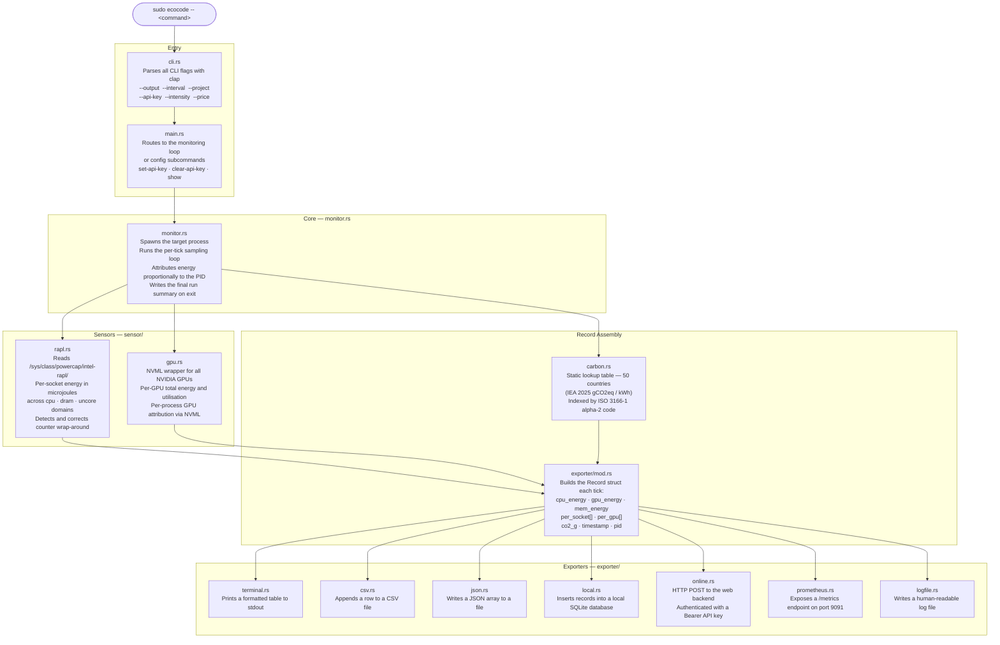

# EcoCode CLI — Architecture

## How it works

1. `cli.rs` parses the command-line flags and `main.rs` decides whether to enter the monitoring loop or handle a `config` subcommand.
2. `monitor.rs` spawns the target process and enters a tick loop. On every interval it calls both sensor modules in parallel.
3. `rapl.rs` reads the Linux RAPL sysfs files and returns per-socket, per-domain energy deltas in joules. `gpu.rs` queries NVML for per-GPU energy and attributes a fraction to the monitored PID based on utilisation.
4. `exporter/mod.rs` assembles a `Record` from the sensor readings. `carbon.rs` enriches it with a CO2 estimate derived from the configured grid intensity.
5. The selected exporter writes or transmits the record. Multiple exporters can be active at once. When the target process exits, `monitor.rs` writes a final summary.

## File reference

| File | Responsibility |
|------|----------------|
| `cli.rs` | All CLI flag definitions (clap) |
| `main.rs` | Entry point and subcommand dispatch |
| `monitor.rs` | Process spawning, sampling loop, PID energy attribution, run summary |
| `carbon.rs` | Static 50-country CO2 intensity table (IEA 2025) |
| `sensor/mod.rs` | Sensor module hub, defines `RAPL_PATH` |
| `sensor/rapl.rs` | Intel RAPL sysfs reader — CPU, DRAM, iGPU energy per socket |
| `sensor/gpu.rs` | NVML wrapper — per-GPU and per-process energy and utilisation |
| `exporter/mod.rs` | `Record` struct definition and exporter trait |
| `exporter/terminal.rs` | Stdout table output |
| `exporter/csv.rs` | CSV file output |
| `exporter/json.rs` | JSON file output |
| `exporter/local.rs` | SQLite local storage |
| `exporter/online.rs` | HTTP POST to the web backend (premium) |
| `exporter/prometheus.rs` | Prometheus `/metrics` endpoint |
| `exporter/logfile.rs` | Formatted log file output |
