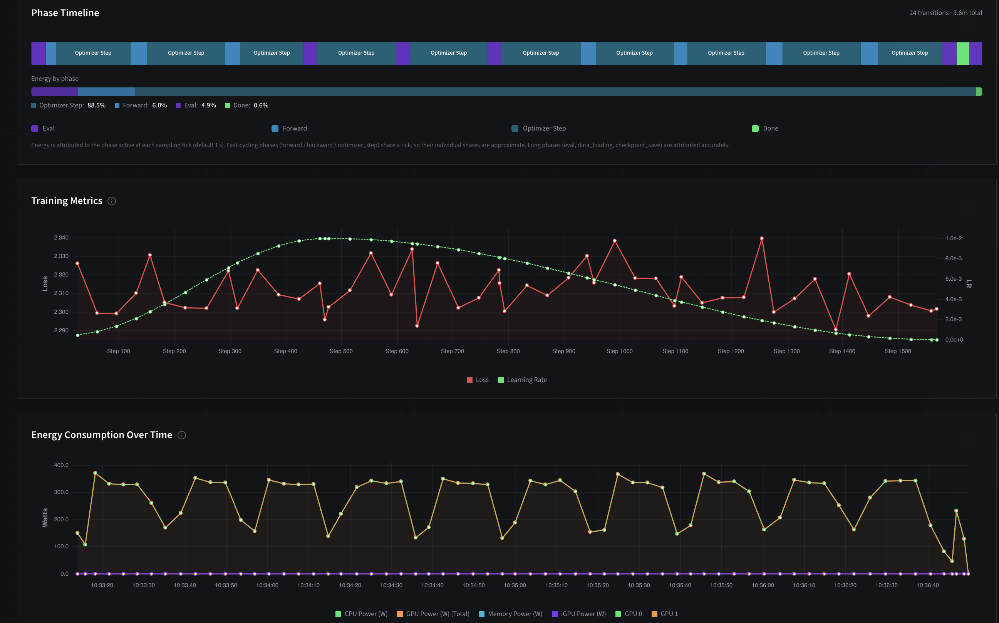

# EcoCode

<div align="center">


**High-precision, multi-GPU energy monitoring for sustainable software development**

[](LICENSE)
[](https://www.rust-lang.org/)

</div>

---

EcoCode is an open-source toolchain that monitors the real-time energy footprint of Linux processes. It tracks **CPU, multiple GPUs, RAM, and integrated GPU** power consumption. 

Unlike other tools that rely on TDP (thermal design power) estimations, EcoCode reads **direct hardware sensors** (Intel RAPL and NVIDIA NVML) in real time. It attributes energy to a monitored process and its child processes proportionally based on their CPU/GPU/memory utilisation.

---

## Live Dashboard Preview

EcoCode comes with a premium-grade collaborative web dashboard. When you run your experiments, metrics are streamed in real time via Server-Sent Events (SSE).



---

## Why EcoCode?

* **Real Hardware Measurements:** Reads actual energy counters directly from Intel RAPL sysfs and NVIDIA NVML, rather than estimating from manufacturer TDP specifications.
* **Per-Process GPU Attribution:** Attributes GPU energy proportionally to the specific monitored process across multiple GPUs independently.
* **Language & Runtime Agnostic:** Run any process out-of-the-box (e.g. C++, Node.js, Python, simulation scripts) using the CLI wrapper, or use the native Python SDK for ML training loops.
* **Team Collaboration:** Group runs under projects, invite team members, manage developer API keys, and track grid carbon intensity.
* **Ultra-Low Overhead:** Written in Rust with asynchronous, non-blocking I/O to ensure minimal monitoring impact.

---

## Quick Start in 2 Minutes

EcoCode can be used as a standalone terminal CLI wrapper or integrated directly into Python scripts.

### Option 1: CLI (Zero Code Changes)
Monitor any process or script from the outside. Download the pre-built binary from the latest Release page or build from source, then run:

```bash
# 1. Save your dashboard API key (optional)
ecocode config set-api-key eco_your_api_key_here

# 2. Run and stream to the web dashboard
ecocode run -o online --project "efficiency-study" -- python train.py
```

### Option 2: Python SDK (In-Code Control)
Perfect for ML training loops where you want to log loss, steps, and epochs alongside energy data.

```bash
pip install ecocode
```

```python
import ecocode

with ecocode.run("llama3-finetune", api_key="eco_...") as run:
    for epoch in range(epochs):
        run.log_epoch(epoch)
        for batch in loader:
            run.mark("phase", "forward")
            loss = model(batch)
            run.log_loss(loss.item())
            run.log_step(global_step)
```

---

## Documentation Hub

For advanced configurations, integration guides, and platform setup, refer to the following sub-folder guides:

* **[Getting Started Tutorial](TUTORIAL.md)** — step-by-step guide: install the CLI, run your first experiment, and use the Python SDK with ML framework callbacks.
* **[CLI Reference & Installation Guide](ecocode/README.md)** — detailed usage, CLI flags, CSV/JSON/logfile/Prometheus exporters, and permissions.
* **[Python SDK & ML Integrations Guide](python-sdk/README.md)** — callback references for HuggingFace, PyTorch Lightning, TRL, Keras, DeepSpeed, vLLM, and ONNX Runtime.
* **[EcoCode CLI Architecture](ARCHITECTURE.md)** — deep dive into sensor readers, wrap-around correction algorithms, and IPC design.

---

## License

EcoCode (CLI and Python SDK) is licensed under the [GNU Affero General Public License v3.0](LICENSE) (AGPL-3.0-only).

You are free to use, modify, and distribute this software under the terms of the AGPL-3.0. If you run a modified version as a network service, you must make the complete corresponding source code available to users of that service.

See the [LICENSE](LICENSE) file for the full license text.

