# EcoCode

<div align="center">


**High-precision, multi-GPU energy monitoring for sustainable software development**

[](LICENSE)
[](https://www.rust-lang.org/)

</div>

---

EcoCode monitors the real-time energy footprint of any Linux process — tracking **CPU, multiple GPUs, RAM, and integrated GPU** power consumption per process using Intel RAPL and NVIDIA NVML. Results can be exported to the terminal, local files, a database, or a Prometheus endpoint. A hosted **web dashboard** with real-time charts, team collaboration, and carbon reporting is available as a premium feature.

---

## Key Features

| Feature | Description |
|---------|-------------|
| **Multi-GPU Monitoring** | Detects and monitors all NVIDIA GPUs via NVML, with per-GPU energy and utilization breakdown |
| **Multi-Socket CPU** | Per-socket RAPL energy readings across CPU core, DRAM, and integrated GPU domains |
| **Process-Level Attribution** | Allocates energy to the monitored PID using proportional CPU and memory usage fractions |
| **7 Export Formats** | Terminal, CSV, JSON, SQLite (local), PostgreSQL (online), Prometheus metrics, and log file |
| **Web Dashboard** | Premium hosted dashboard with real-time SSE-powered charts, per-GPU and per-socket visualisation, and run history |
| **Carbon Footprint** | CO2 estimation using a 50-country intensity table (IEA 2025) or live data from the Electricity Maps API |
| **Team Collaboration** | Premium workspace collaboration with admin and member roles, invitation by email, and workspace-scoped API keys |
| **Low Overhead** | Built in Rust with zero-cost abstractions and asynchronous I/O |

---

## How EcoCode Differs from Existing Tools

Most energy monitoring tools for software rely on estimation: they multiply hardware TDP by CPU utilisation and treat the result as consumed energy. EcoCode takes a different approach — it reads what the hardware actually reports.

### Measurement accuracy

CodeCarbon, Carbontracker, and similar Python libraries estimate power from manufacturer TDP figures. EcoCode reads Intel RAPL sysfs counters (`/sys/class/powercap/intel-rapl/`) and NVIDIA NVML directly. These are the same interfaces used by hardware performance engineers and power-management firmware — they reflect real joules drawn, not modelled approximations.

### Per-process GPU attribution

Most tools that claim GPU monitoring report whole-device power and divide it evenly, or skip it entirely. EcoCode uses NVML `process_utilization_stats` to attribute GPU energy to the specific monitored PID proportionally, across every detected GPU independently.

### Language and runtime agnostic

CodeCarbon requires Python and instruments code through decorators or context managers. EcoCode wraps any executable — `ecocode -- python train.py`, `ecocode -- ./simulation`, `ecocode -- node server.js` — with no changes to the target program.

### Comparison table

| Capability | EcoCode | CodeCarbon | Scaphandre | Carbontracker |
|---|:---:|:---:|:---:|:---:|
| Real hardware energy (RAPL) | Yes | No | Yes | No |
| Real GPU energy (NVML) | Yes | No | No | No |
| Per-process GPU attribution | Yes | No | No | No |
| Multi-GPU per-device breakdown | Yes | No | No | No |
| Multi-socket per-domain breakdown | Yes | No | No | No |
| Any language / any process | Yes | Python only | Yes | Python only |
| Live real-time dashboard (SSE) | Yes | No | No | No |
| Team workspaces and collaboration | Yes | No | No | No |
| Prometheus export | Yes | No | Yes | No |
| Live grid carbon intensity (API) | Yes | Partial | No | No |
| Counter wrap-around correction | Yes | No | No | No |

Scaphandre is the closest alternative on the measurement side — it is also RAPL-based — but it has no GPU support, no web dashboard, no carbon estimation, and no developer workflow integration. It is designed as a production infrastructure exporter, not a per-experiment tool.

---

## Architecture

The system has three independent layers: a Rust CLI that wraps any process and reads hardware energy counters, an Axum REST backend that stores and serves measurements, and a Next.js frontend that visualises runs in real time via Server-Sent Events.

```mermaid
flowchart TD
    User(["User\nsudo ecocode -- python train.py"])

    subgraph CLI["EcoCode CLI — ecocode/src/"]
        direction TB
        cli["cli.rs\nDefines all CLI flags via clap:\n--output  --interval  --project\n--api-key  --intensity  --price"]
        main_cli["main.rs\nEntry point: routes to monitor loop\nor config subcommands\n(set-api-key / clear-api-key / show)"]
        monitor["monitor.rs\nSpawns target process\nRuns per-tick sampling loop\nAttributes energy to monitored PID\nWrites final run summary"]
        carbon_tbl["carbon.rs\n50-country static CO2 table\n(IEA 2025 gCO2eq/kWh)\nLookup by ISO 3166-1 alpha-2 code"]

        subgraph Sensors["sensor/"]
            rapl["rapl.rs\nReads /sys/class/powercap/intel-rapl/\nPer-socket energy in μJ:\ncpu · dram · uncore (iGPU domains)\nHandles counter wrap-around"]
            nvml["gpu.rs\nNVML wrapper — all NVIDIA GPUs\nPer-GPU total energy + utilisation\nPer-process GPU attribution"]
        end

        exp_mod["exporter/mod.rs\nDefines the Record struct:\ncpu_energy · gpu_energy · mem_energy\nper_socket[] · per_gpu[]\nco2_g · timestamp · pid"]

        subgraph Exporters["exporter/"]
            exp_t["terminal.rs\nFormatted table to stdout"]
            exp_c["csv.rs\nAppend rows to CSV file"]
            exp_j["json.rs\nWrite JSON array to file"]
            exp_l["local.rs\nInsert into local SQLite database"]
            exp_o["online.rs\nHTTP POST to /api/ingest\nAuthenticated with Bearer API key"]
            exp_p["prometheus.rs\nExpose /metrics on HTTP port 9091"]
            exp_f["logfile.rs\nWrite formatted log file"]
        end
    end

    subgraph Backend["Web Backend — web/backend/src/"]
        direction TB
        main_be["main.rs\nAxum server on :3001\nConnects PostgreSQL pool\nRuns schema migrations\nRegisters CORS + all routes\nSpawns SSE broadcast task"]

        subgraph BAuth["auth/"]
            a_mod["mod.rs\nRoutes: POST /register · POST /login\nGET/POST /api-keys\nSets 30-day HttpOnly JWT cookie"]
            a_jwt["jwt.rs\nSign and verify JWT tokens"]
            a_mw["middleware.rs\nAuthUser extractor:\naccepts JWT cookie or Bearer API key"]
            a_pw["password.rs\nArgon2id password hashing\nSHA-256 API key hashing"]
        end

        subgraph BAPI["api/"]
            ingest["ingest.rs\nPOST /api/ingest/run — create run\nPOST /run/{id}/record — append tick\nPOST /run/{id}/system-info — hardware\nPOST /run/{id}/complete — finalise"]
            runs_api["runs.rs\nGET runs · records · summaries\nfor a workspace or project"]
            proj_api["projects.rs\nCRUD endpoints for projects\n(workspace-scoped)"]
            sse_h["sse.rs\nGET /api/sse\nBroadcasts each new Record\nto all connected clients"]
            carbon_h["carbon.rs\nFetch / save carbon config\nProxy to Electricity Maps API\nfor live grid intensity"]
            admin_h["admin.rs\nAdmin-only: list runs\nacross all workspaces"]
        end

        subgraph BDB["db/"]
            schema_db["schema.rs\nCreates all tables on startup:\nusers · workspaces · workspace_members\napi_keys · projects · runs · records\nrecord_gpu_metrics · record_socket_metrics\nrun_summaries"]
            rec_db["records.rs\nInsert measurement records\nwith GPU and socket breakdowns\nQuery records for a run"]
            run_db["runs.rs\nRun CRUD: create · update status\nfetch by id / workspace / project"]
        end
    end

    subgraph Frontend["Web Frontend — web/frontend/"]
        direction TB
        subgraph FPages["app/ — Pages (Next.js App Router)"]
            run_pg["runs/[id]/page.tsx\nLive run dashboard:\ncharts + system info + carbon summary"]
            runs_list["runs/page.tsx\nPaginated run list with filters"]
            proj_pg["projects/[id]/page.tsx\nProject detail and run history"]
            auth_pg["login/page.tsx + register/page.tsx\nJWT authentication forms"]
            ws_pg["[workspaceSlug]/page.tsx\nWorkspace home: recent runs\nand summary stats"]
            settings_pg["settings/developer/page.tsx\nCreate and revoke API keys"]
        end

        subgraph FCharts["components/charts/"]
            ec["EnergyChart.tsx\nCumulative energy over time\n(Recharts line chart)"]
            pd["PowerDistributionChart.tsx\nCPU vs GPU vs RAM split\n(stacked area)"]
            sc["SocketEnergyChart.tsx\nPer-socket RAPL breakdown"]
            uc["UtilizationChart.tsx\nCPU + GPU utilisation % over time"]
            cc["CumulativePowerChart.tsx\nRunning total power draw"]
        end

        sse_hook["hooks/use-sse.ts\nSubscribes to GET /api/sse\nAppends incoming records to\nchart state in real time"]

        api_lib["lib/api/\nruns.ts · projects.ts · carbon.ts · admin.ts\nTyped fetch wrappers — all calls\nsend the JWT cookie automatically"]
    end

    DB[("PostgreSQL — Neon / TimescaleDB\nruns · records\nrecord_gpu_metrics\nrecord_socket_metrics\nrun_summaries\nworkspaces · users · api_keys · projects")]

    User --> cli --> main_cli --> monitor
    monitor --> rapl & nvml
    monitor --> carbon_tbl
    rapl & nvml --> exp_mod
    carbon_tbl --> exp_mod
    exp_mod --> exp_t & exp_c & exp_j & exp_l & exp_o & exp_p & exp_f

    exp_o -- "POST /api/ingest/{id}/record\nBearer API key" --> ingest
    ingest --> rec_db --> DB
    ingest --> run_db --> DB

    schema_db -. "runs once at startup" .-> DB

    sse_h -- "SSE stream\n(new records)" --> sse_hook
    sse_hook --> run_pg
    run_pg --> ec & pd & sc & uc & cc

    api_lib -- "REST + JWT cookie" --> runs_api & proj_api & carbon_h
    runs_api --> run_db
    proj_api --> run_db

    auth_pg --> a_mod --> a_jwt & a_pw
    a_mw -. "validates every\nprotected request" .-> BAPI
```



### Data flow summary

1. The user runs `ecocode -- <command>`. `cli.rs` parses flags; `monitor.rs` spawns the child process and starts sampling.
2. On every tick, `rapl.rs` reads RAPL sysfs counters and `gpu.rs` queries NVML. `exporter/mod.rs` assembles a `Record` struct and optionally enriches it with CO2 via `carbon.rs`.
3. The selected exporter writes the record. With `--output online`, `online.rs` sends it to the backend via an authenticated HTTP POST.
4. The Axum backend (`ingest.rs`) inserts the record and its per-GPU and per-socket breakdowns into PostgreSQL, then broadcasts it to `sse.rs`.
5. The Next.js frontend holds an open SSE connection (`use-sse.ts`). Each incoming record is appended to chart state, so the run dashboard updates live without polling.

---

## Getting Started

EcoCode has two independent tools you can use together or separately:

| Tool | What it is | Who should use it |
|------|-----------|-------------------|
| **CLI** | Wraps any process (`python`, `./simulation`, `node server.js`) and monitors its energy from the outside. Requires `sudo`. | Anyone who wants to measure energy without modifying code, or who wants attached mode with higher RAPL accuracy |
| **Python SDK** | A native Rust extension imported directly inside a Python script. No `sudo` required. | ML researchers and engineers who want in-code control over phases, loss, steps, tokens, and other training metrics |

Both tools report to the same [web dashboard](https://blacktree-5d3c8de6.eastus.azurecontainerapps.io) and use the same API key.

---

### Prerequisites

| Requirement | CLI | Python SDK |
|-------------|:---:|:----------:|
| Linux (kernel 3.10+) | Required | Required |
| Rust 1.70+ | Required (to build) | Required (to build) |
| `sudo` / root access | Required | Not required |
| NVIDIA drivers (NVML) | Optional — GPU monitoring | Optional — GPU monitoring |
| Python 3.9+ | Not required | Required |
| Maturin | Not required | Required (build backend) |

Install Rust if you do not have it:

```bash
curl --proto '=https' --tlsv1.2 -sSf https://sh.rustup.rs | sh
```

---

### Option 1 — CLI

**Use this when:** you want to monitor any process without changing its code, or you want attached mode.

**Step 1: Build**

```bash
git clone https://github.com/MohamedAziz-Khezami/EcoCode.git
cd EcoCode/ecocode
cargo build --release
# Binary is at: ecocode/target/release/ecocode
```

**Step 2: Get an API key**

1. Go to the [dashboard](https://blacktree-5d3c8de6.eastus.azurecontainerapps.io) and create an account.
2. Navigate to Settings → Developer → select a project → Generate Key.
3. Save the key once so you do not have to pass it on every run:

```bash
./target/release/ecocode config set-api-key eco_...
```

**Step 3: Run**

```bash
# Monitor any process — live output to terminal
sudo ./target/release/ecocode -- python train.py

# Send results to the web dashboard
sudo ./target/release/ecocode -o online -p "my-project" -- python train.py

# Save to CSV
sudo ./target/release/ecocode -o csv -f results.csv -- python train.py

# Save to JSON
sudo ./target/release/ecocode -o json -f results.json -- python train.py

# Write a formatted log file
sudo ./target/release/ecocode -o logfile -f run.log -- python train.py

# Save locally to SQLite (no backend needed)
sudo ./target/release/ecocode -o local --collaborator "alice" -- python train.py

# Expose a Prometheus /metrics endpoint on port 9091
sudo ./target/release/ecocode -o prometheus -- python train.py

# Custom sampling interval (default: 1 second)
sudo ./target/release/ecocode -i 0.5 -o online -- python train.py

# Monitor any executable, not just Python
sudo ./target/release/ecocode -o online -- ./my_simulation
sudo ./target/release/ecocode -o online -- node server.js
```

**CLI flag reference:**

| Flag | Description | Default |
|------|-------------|---------|
| `-o, --output` | Export format: `terminal`, `csv`, `json`, `local`, `online`, `prometheus`, `logfile` | `terminal` |
| `-f, --file` | Output file path (required for `csv`, `json`, `logfile`) | — |
| `-p, --project` | Project name for grouping runs | `ecocode` |
| `--collaborator` | Name of the person running the experiment | — |
| `-i, --interval` | Sampling interval in seconds (supports decimals) | `1.0` |
| `--intensity` | Carbon intensity override in gCO2eq/kWh | project default |
| `--price, --cost` | Electricity cost per kWh for financial estimation | — |
| `--address` | Location for automatic carbon intensity lookup | — |
| `--api-key` | API key for the `online` exporter | — |

**Config subcommands:**

```bash
ecocode config set-api-key <KEY>   # save API key once
ecocode config show                # view current config
ecocode config clear-api-key       # remove saved key
```

---

### Option 2 — Python SDK

**Use this when:** you are writing a Python ML training or inference script and want to log phases, loss, learning rate, tokens, and other training metrics alongside energy data. No `sudo` required.

**Step 1: Install**

```bash
git clone https://github.com/MohamedAziz-Khezami/EcoCode.git
cd EcoCode/python-sdk

pip install maturin                # build backend — needed once
pip install -e ".[gpu]"            # with GPU energy tracking (recommended)
pip install -e ".[all]"            # with all framework callbacks
pip install -e "."                 # core only (CPU + memory, no GPU)
```

**Step 2: Get an API key**

Same as above — dashboard → Settings → Developer → Generate Key.

**Step 3: Add three lines to your script**

```python
import ecocode

with ecocode.run("my-experiment", api_key="eco_...") as run:
    # your existing training code goes here, unchanged
    for epoch in range(epochs):
        run.log_epoch(epoch)
        for batch in loader:
            loss = model(batch)
            run.log_loss(loss.item())
            run.log_step(global_step)
```

The run appears on the dashboard automatically. No other configuration needed — the backend URL is built into the SDK.

**Step 4 (optional): Use a framework callback**

If you use HuggingFace Trainer, TRL, PyTorch Lightning, Keras, DeepSpeed, vLLM, or ONNX Runtime, a dedicated callback handles all marker calls automatically:

```python
# HuggingFace Trainer
from ecocode.integrations.huggingface import EcoCodeCallback

with ecocode.run("sft-llama3", api_key="eco_...") as eco_run:
    trainer = Trainer(model=model, callbacks=[EcoCodeCallback(eco_run)])
    trainer.train()
```

```python
# TRL — SFT / DPO / GRPO
from ecocode.integrations.trl import EcoCodeSFTCallback

with ecocode.run("grpo-qwen", api_key="eco_...") as eco_run:
    trainer = GRPOTrainer(model=model, callbacks=[EcoCodeGRPOCallback(eco_run)])
    trainer.train()
```

See `python-sdk/README.md` for the full callback list and ML marker API reference.

---

### Option 3 — CLI + Python SDK together (attached mode)

**Use this when:** you want both the CLI's guaranteed RAPL file access (root) and the SDK's in-code marker API (phase, loss, step, tokens), with zero measurement overhead on the training process.

```bash
# 1. Start the CLI as root — it creates the run and starts sampling
sudo ./target/release/ecocode -o online -p "my-project" -- python train.py
```

```python
# train.py — SDK auto-detects attached mode from the env vars the CLI injected
import ecocode

with ecocode.run() as run:   # no api_key needed
    run.mark("phase", "forward")
    run.log_step(100)
    run.log_loss(1.23)
```

The CLI injects `ECOCODE_SOCKET` and `ECOCODE_RUN_ID` into the child process environment. The SDK detects them and switches to attached mode automatically — no code change needed beyond importing ecocode.

---

## What Gets Monitored

| Metric | Source | Granularity |
|--------|--------|-------------|
| CPU Usage (%) | `sysinfo` | Per-process |
| CPU Energy (J) | Intel RAPL `/sys/class/powercap/intel-rapl/` | Per-socket, per-domain (cpu, dram, igpu) |
| GPU Usage (%) | NVML `process_utilization_stats` | Per-GPU, per-process |
| GPU Energy (J) | NVML `total_energy_consumption` | Per-GPU |
| Memory Usage (%) | `sysinfo` | Per-process |
| Memory Energy (J) | RAPL DRAM domain | Per-socket |
| iGPU Energy (J) | RAPL uncore domain | Per-socket |

Energy is stored in Joules (1 Wh = 3600 J).

### Multi-GPU Support

EcoCode detects all NVIDIA GPUs at startup and monitors each independently:

- **Aggregate metrics** (`gpu_usage`, `gpu_energy`) are stored as totals for backward-compatible summaries.
- **Per-GPU metrics** are stored in a separate `gpu_records` table keyed by `device_index`.

### Multi-Socket CPU Support

RAPL scanning handles multiple CPU sockets automatically. Per-socket energy deltas are stored in a `socket_records` table with `socket`, `domain` (`cpu`, `dram`, `igpu`), and `energy` per record.

### Counter Wrap-Around Handling

Both RAPL and NVML counters are monotonically increasing integers that reset to zero on hardware events (driver reload, GPU reset). EcoCode tracks the running maximum for each counter and applies a correction when a backward jump is detected, ensuring no energy is lost across counter resets.

---

## Carbon Footprint Estimation

The formula used is:

```
CO2 (g) = energy_kWh * intensity_gCO2_per_kWh * PUE
```

Where:
- `energy_kWh` = total energy (CPU + GPU + Memory + iGPU) converted from Joules
- `intensity_gCO2_per_kWh` = grid carbon intensity for the configured region
- `PUE` = Power Usage Effectiveness factor (1.0 for workstations, ~1.58 for average data centres)

Carbon intensity can be set in three ways, in order of precedence:
1. **Live API** — real-time data from [Electricity Maps](https://electricitymaps.com/) when a project is configured with a location and API key.
2. **Static table** — 50+ country values sourced from IEA 2025 data, selectable by country code.
3. **Global average** — 445 gCO2eq/kWh (IEA Emissions Factors 2025, fallback when no configuration is present).

Environmental equivalents derived from the run's CO2 figure:

| Equivalent | Factor | Source |
|---|---|---|
| Car distance | 170 gCO2/km | IEA global passenger car fleet average |
| Smartphone charges | 8.2 gCO2/charge | ~16 Wh battery at world-average grid intensity |
| Trees (1-day absorption) | 22 kg CO2/year per tree | One Tree Planted / EcoTree species average |

---

## Repository Structure

```
ecocode/
├── ecocode/             # Rust CLI binary + exporters
│   ├── src/
│   │   ├── main.rs          # Entry point; routes to monitor loop or config subcommands
│   │   ├── cli.rs           # clap argument definitions (all CLI flags)
│   │   ├── monitor.rs       # Core sampling loop; process spawning; Unix socket listener
│   │   ├── carbon.rs        # CO2 calculation formula + 50-country static table (IEA 2025)
│   │   ├── configs.rs       # `ecocode config` subcommand handler
│   │   └── exporter/
│   │       ├── mod.rs           # Exporter trait + Record / GpuMetric / SocketMetric types
│   │       ├── terminal.rs      # Live table to stdout
│   │       ├── csv.rs           # Append rows to CSV
│   │       ├── json.rs          # Write JSON array file
│   │       ├── local.rs         # SQLite (local database)
│   │       ├── online.rs        # HTTP POST to web backend (Bearer API key)
│   │       ├── prometheus.rs    # Prometheus /metrics endpoint on :9091
│   │       ├── logfile.rs       # Human-readable log file
│   │       └── dual.rs          # Fan-out: sends to both primary + online simultaneously
│   └── crates/core/         # Shared sensor library (CLI and Python SDK both depend on this)
│       └── src/
│           ├── sensor/rapl.rs   # RAPL sysfs reader (scan, read, delta, wrap-around)
│           ├── sensor/gpu.rs    # NVML GPU reader (per-device + per-process attribution)
│           └── http_client.rs   # Blocking HTTP client for Python SDK sampler thread
│
├── python-sdk/          # Python SDK (Rust extension via PyO3 + Maturin)
│   ├── src/
│   │   ├── lib.rs           # EcoCodeRun PyO3 class — context manager and all log_* methods
│   │   ├── sampler.rs       # Background sampling + reporter threads (standalone mode)
│   │   └── socket_client.rs # Unix domain socket client for attached mode
│   ├── ecocode/             # Pure-Python public API layer
│   │   ├── __init__.py      # run() and track() factory functions
│   │   └── integrations/    # Callbacks: HuggingFace, TRL, Lightning, DeepSpeed, vLLM, Keras, ONNX
│   └── demo_*.py            # End-to-end examples for each supported framework
│
└── web/                 # Web platform
    ├── backend/         # Axum REST + SSE server (Rust, listens on :3001)
    │   └── src/
    │       ├── main.rs          # App init, DB pool, route registration, SSE watcher
    │       ├── api/
    │       │   ├── ingest.rs    # Ingestion endpoints called by CLI/SDK
    │       │   ├── runs.rs      # Run + record retrieval with nested GPU/socket details
    │       │   ├── projects.rs  # Project CRUD (workspace-scoped)
    │       │   ├── sse.rs       # SSE handler + PostgreSQL LISTEN/NOTIFY watcher
    │       │   ├── carbon.rs    # Carbon config + Electricity Maps API proxy
    │       │   └── admin.rs     # Admin-only cross-workspace queries
    │       ├── auth/            # JWT auth, Argon2id password hashing, API key management
    │       ├── db/
    │       │   ├── schema.rs    # Idempotent schema migrations applied at startup
    │       │   ├── records.rs   # Record insert + query helpers
    │       │   └── runs.rs      # Run summary calculation
    │       ├── models/          # Serde structs for DB rows and API payloads
    │       ├── services/        # Carbon API integration (Electricity Maps proxy)
    │       ├── workspaces/      # Workspace + member management endpoints
    │       └── state.rs         # AppState: PG pool + SSE broadcast sender
    │
    └── frontend/        # Next.js 14 dashboard (TypeScript + Tailwind + react-chartjs-2)
        ├── app/
        │   ├── login/ + register/       # Authentication pages
        │   └── [workspaceSlug]/
        │       ├── page.tsx             # Workspace home (recent runs, summary stats)
        │       ├── runs/[id]/page.tsx   # Live run detail: charts, system info, carbon
        │       ├── projects/            # Project list + per-project run history
        │       └── settings/            # Account, API keys, team member management
        ├── components/
        │   ├── charts/          # EnergyChart, UtilizationChart, SocketEnergyChart,
        │   │                    # PowerDistributionChart, PhaseTimeline, TrainingMetrics
        │   ├── run/             # RunSystemInfo, EnvironmentalImpact, MLMetricsBar
        │   ├── tables/          # RunsTable, ProjectsTable
        │   ├── layout/          # DashboardLayout, Sidebar, WorkspaceProvider context
        │   └── ui/              # shadcn/ui base components (button, card, dialog, table…)
        ├── lib/
        │   ├── api/             # Typed fetch wrappers (runs.ts, projects.ts, carbon.ts)
        │   ├── mock-data.ts     # Frontend type definitions (MetricRecord, Run, GpuMetric…)
        │   └── utils.ts         # Chart time formatting, min interval calculation
        └── hooks/
            └── use-sse.ts       # SSE subscription hook — live record updates to charts
```

---

## Python SDK

The Python SDK provides a context manager and decorator API for instrumenting ML training scripts. It is a Rust extension module built with PyO3 and Maturin, using the same RAPL and NVML sensor code as the CLI.

### Installation

```bash
cd python-sdk
pip install -e ".[gpu]"          # with GPU support (recommended)
pip install -e ".[all]"          # with all framework integrations
```

### Standalone Mode

No CLI required. The SDK manages run creation and hardware sampling internally.

```python
import ecocode

with ecocode.run(
    "llama3-finetune",
    api_key="eco_...",            # or set ECOCODE_API_KEY
    project_id=42,
    interval=1.0,
) as run:

    run.mark("phase", "data_loading")

    for epoch in range(10):
        run.log_epoch(epoch)
        for step, batch in enumerate(loader):
            run.mark("phase", "forward")
            output = model(batch)

            run.mark("phase", "backward")
            output.loss.backward()

            run.mark("phase", "optimizer_step")
            optimizer.step()

            run.log_step(step)
            run.log_loss(output.loss.item())
            run.log_lr(scheduler.get_last_lr()[0])
            run.log_tokens(tokens_seen)
```

### Attached Mode (CLI + sudo)

The CLI handles energy sampling; the SDK sends only semantic markers via a Unix socket.

```bash
sudo ecocode -o online --api-key eco_... -p my-project -- python train.py
```

```python
# train.py — no api_key needed; ECOCODE_SOCKET + ECOCODE_RUN_ID are injected by CLI
import ecocode

with ecocode.run() as run:
    run.mark("phase", "forward")
    run.log_step(100)
    run.log_loss(1.23)
```

### Framework Integrations

| Framework | Import | Works with |
|-----------|--------|-----------|
| HuggingFace Transformers | `ecocode.integrations.huggingface.EcoCodeCallback` | `Trainer` |
| TRL | `ecocode.integrations.trl.EcoCodeSFTCallback` | `SFTTrainer`, `DPOTrainer`, `GRPOTrainer` |
| PyTorch Lightning | `ecocode.integrations.lightning.EcoCodeCallback` | `pl.Trainer` |
| DeepSpeed | `ecocode.integrations.deepspeed.EcoCodeDeepSpeedCallback` | Manual hooks |
| vLLM | `ecocode.integrations.vllm.EcoCodeVLLMMiddleware` | `AsyncLLMEngine` |
| Keras | `ecocode.integrations.keras.EcoCodeCallback` | `model.fit()` |
| ONNX Runtime | `ecocode.integrations.onnxruntime.EcoCodeORTWrapper` | `InferenceSession` |

```python
# HuggingFace example
from ecocode.integrations.huggingface import EcoCodeCallback

with ecocode.run("sft-llama3", api_key="eco_...", project_id=42) as r:
    trainer = Trainer(model=model, callbacks=[EcoCodeCallback(r)])
    trainer.train()
```

See `python-sdk/README.md` for the full ML marker API reference and integration details.

---

## Use Cases

### Research — Comparing Experiment Energy Cost

```bash
# Run baseline and optimized variants back-to-back
sudo ecocode -o online --project "efficiency-study" --name "fp32-baseline" \
    -- python train.py --precision fp32

sudo ecocode -o online --project "efficiency-study" --name "bf16-amp" \
    -- python train.py --precision bf16

# The dashboard's run comparison panel shows side-by-side energy and CO2 figures
```

### CI/CD — Per-Commit Energy Regression Tracking

```bash
# In GitHub Actions or similar CI:
sudo ecocode -o online \
    --project "ci-energy" \
    --name "commit-${GITHUB_SHA:0:8}" \
    -- python run_benchmarks.py
```

### Local Analysis Without a Backend

```bash
# Write to CSV and open in pandas / Excel
sudo ecocode -o csv -f results.csv -- python train.py

# Query with pandas
import pandas as pd
df = pd.read_csv("results.csv")
print(f"Total GPU energy: {df['gpu_energy'].sum():.2f} J")
print(f"Peak CPU usage:   {df['cpu_usage'].max():.1f}%")
```

### Prometheus + Grafana Integration

```bash
# Expose metrics
sudo ecocode -o prometheus -- python train.py
# Prometheus scrapes http://localhost:9091/metrics
# Import the EcoCode Grafana dashboard JSON from web/grafana/
```

### Inference Energy Profiling (vLLM)

```python
import ecocode
from ecocode.integrations.vllm import EcoCodeVLLMMiddleware

with ecocode.run("llama3-serving", api_key="eco_...", project_id=5) as r:
    engine = EcoCodeVLLMMiddleware(AsyncLLMEngine.from_engine_args(args), r)
    # Automatically marks prefill / decode phases and logs cumulative tokens
    async for output in engine.generate(prompt, sampling_params, request_id):
        yield output
```

---

## Environment Variables

| Variable | Component | Description |
|----------|-----------|-------------|
| `ECOCODE_API_KEY` | CLI, SDK | API key for the online exporter |
| `ECOCODE_API_URL` | CLI, SDK | Backend base URL (default: `http://localhost:3001`) |
| `ECOCODE_SOCKET` | SDK | Unix socket path injected by CLI in attached mode |
| `ECOCODE_RUN_ID` | SDK | Run ID injected by CLI in attached mode |
| `DATABASE_URL` | Backend | PostgreSQL connection string |
| `CORS_ORIGIN` | Backend | Allowed frontend origin (default: `http://localhost:3000`) |
| `RUST_LOG` | Backend | Log level: `trace` / `debug` / `info` / `warn` / `error` |
| `NEXT_PUBLIC_API_URL` | Frontend | Backend base URL seen by the browser |

---

## TODO / Next Steps

- [ ] **Add Windows support**: A custom made driver is probably needed.
- [ ] **Run comparison UI**: Side by side time-series comparison of multiple runs.
- [ ] **Jupyter extension**: Add UI for running and viewing energy results in Jupyter notebooks.
- [ ] **VSCode extension**: Add UI for running and viewing energy results in VSCode.
- [ ] **Frontend performance for long runs**: The run detail page fetches all records in a single request. Runs longer than a few hours produce thousands of records. Implement virtual scroll with paginated record fetching.
- [ ] **CSV/JSON exporter summaries**: The terminal and logfile exporters print a final energy summary; CSV and JSON do not. Implement `run_summary()` for these exporters.
- [ ] **SDK PyPI distribution**: Set up Maturin CI wheels for Linux (x86_64, aarch64) and publish the SDK to PyPI so users can install with `pip install ecocode` without a local Rust build.
- [ ] **A global map view**: of all the runs with circles centered at their location (for the runs that have a location). If the user is not logged in, show public runs only. If logged in, show all runs. Clicking a circle should show a popup with the run details.

---

## Contributing

```bash
# Development workflow
cargo fmt       # format code
cargo clippy    # lint
cargo build     # compile
```

Contributions are welcome. Open an issue to discuss a change before submitting a pull request.

---

## License

...

---

<div align="center">

**Building a sustainable future for AI, one watt at a time**

</div>
