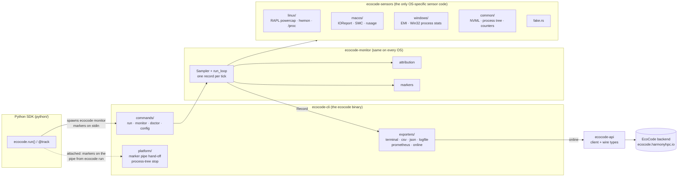

# EcoCode architecture

EcoCode measures how much energy a program uses. It reads the machine's energy sensors, measures
the program's (and its child processes') share of CPU, memory and GPU, and turns that into energy
attributed to the program, once per sampling interval, then sends each sample to an exporter.

## Crates

| Crate | Role | OS-specific? |
|---|---|---|
| [`ecocode-sensors`](../crates/ecocode-sensors) | Energy sensors and per-process statistics behind two traits, `EnergySensor` and `ProcessInspector`. `detect()` picks the implementations for the OS and never fails: a missing or unreadable sensor becomes a diagnostic. | Yes, the only crate with OS-specific sensor code |
| [`ecocode-monitor`](../crates/ecocode-monitor) | The measurement engine: `Sampler` and `run_loop` (the single sampling loop), attribution, marker parsing, the `Record` type and the `Sink` trait. | No |
| [`ecocode-api`](../crates/ecocode-api) | Blocking HTTP client and wire types for the backend. The backend URL is a constant. | No |
| [`ecocode-cli`](../crates/ecocode-cli) | The `ecocode` binary: commands, exporters and the `platform` module (marker pipe hand-off, stopping a process tree). | `platform/` only |
| [`python/`](../python) | The Python SDK. Its wheels bundle the `ecocode` binary. | `_pipe/` (fd vs handle), `_sysinfo.py` |

## One sample

Every interval (`--interval`, default 1 s), `Sampler::sample`:

1. Refreshes the process table and builds the process tree (root PID + all descendants).
2. Measures the tree's CPU time and memory with the `ProcessInspector`, giving its share of total
   CPU capacity and of physical memory.
3. Reads every `EnergySensor`: energy per channel since the previous read, already corrected for
   counter wrap-around or reset.
4. Attributes each channel's energy to the tree (see below).
5. Attaches the latest markers (phase, step, loss, …) and emits one `Record` to the sink.

The loop runs on a plain thread at a fixed interval; a late tick schedules the next one a full
interval later. The online exporter only enqueues records (a background thread uploads them), so a
slow backend never delays sampling.

## Attribution

| Domain | Rule |
|---|---|
| CPU (RAPL, EMI, hwmon, SMC) | Channel energy × the tree's share of total CPU capacity |
| CPU (Apple Silicon) | Per-process CPU energy measured by macOS (`ri_energy_nj`), capped at the CPU total |
| DRAM | Channel energy × the tree's share of physical memory |
| iGPU / uncore, unknown domains | CPU share |
| NVIDIA GPU | Channel energy × the tree's share of GPU activity from NVML per-process samples |
| Apple GPU | The whole GPU's energy while the tree is using the GPU (last 5 s), else none |
| Apple Neural Engine | CPU share |

Golden tests (`crates/ecocode-monitor/tests/golden_attribution.rs`) pin the Linux numbers to those
of the pre-restructure implementation.

## Platforms

| | Linux | macOS | Windows |
|---|---|---|---|
| CPU energy | RAPL (powercap), hwmon fallback | IOReport (Apple Silicon), SMC (Intel) | Energy Meter Interface, where present |
| GPU energy | NVML | IOReport (Apple GPU) | NVML |
| Process stats | `/proc` (PSS memory) | `proc_pid_rusage` (footprint, energy) | `GetProcessTimes`, private working set |
| Marker pipe | inherited fd, `ECOCODE_MARKER_FD` | inherited fd, `ECOCODE_MARKER_FD` | inherited handle, `ECOCODE_MARKER_HANDLE` |
| Stopping a run | SIGTERM, then SIGKILL, to the tree | same | Job Object (kill on close) |

Details: [Linux](platforms/linux.md) · [macOS](platforms/macos.md) · [Windows](platforms/windows.md).

## Modes

- **`ecocode run -- <command>`**: the CLI spawns the command, passes it a marker pipe and
  `ECOCODE_RUN_ID`, and samples it until it exits (or Ctrl+C).
- **Python SDK, standalone**: `ecocode.run(...)` starts `ecocode monitor` (online) or
  `ecocode monitor-local` (terminal/CSV/JSON/logfile) on the Python process itself and writes
  markers to its stdin. Closing stdin ends the run after one final sample.
- **Python SDK, attached**: inside `ecocode run`, the SDK finds the run ID and marker pipe in its
  environment and only sends markers; the CLI does the measuring.

## Testing

- `cargo test --workspace`: unit, golden and end-to-end tests, using fake sensors
  (`--sensors fake`) so they pass on any machine.
- `cargo test --workspace -- --ignored`: tests against this machine's real sensors.
- `pytest` in `python/`: SDK unit tests and end-to-end tests against the built binary.
- `scripts/selftest.sh` / `scripts/selftest.ps1`: all of the above plus measured runs, with a report.
- CI (`.github/workflows/ci.yml`) runs the tests on Linux x86_64/arm64, macOS arm64/x86_64 and
  Windows x86_64, and builds the wheels.
