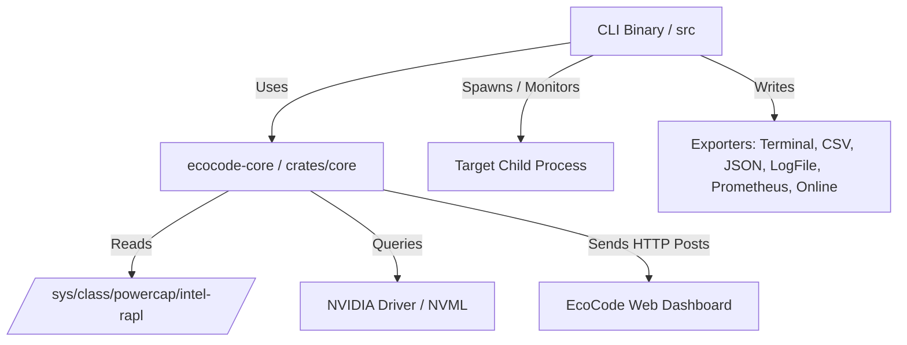
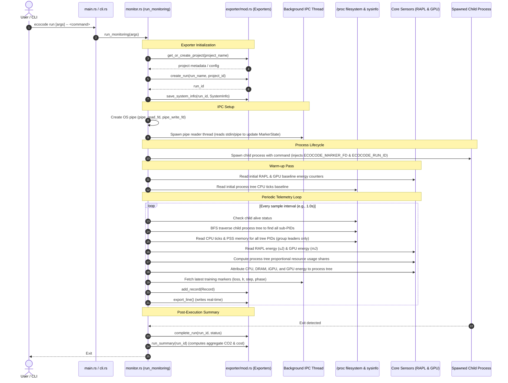

# EcoCode Core Architecture & Flow Analysis

> **Note:** written before the workspace restructure. Source links point to the files' new locations, but line numbers in the links may be out of date.

EcoCode is an application designed to monitor the energy consumption, carbon footprint, and financial cost of executing code (especially training machine learning models). It supports fine-grained monitoring at the process level and attributes energy consumption proportionally to a target process and all its sub-processes.

This report provides a detailed breakdown of the codebase located in the `ecocode` directory.

---

## 1. Architectural Overview

The EcoCode directory contains a workspace with two primary components:
1. **`ecocode-core` (Library Crate - `crates/core`)**: Implements low-level sensor readers (Intel RAPL, NVIDIA GPU via NVML) and a blocking HTTP client to interact with the EcoCode web backend.
2. **`ecocode` (Binary Crate - `src`)**: Implements the command-line interface (CLI), configures the exporters, establishes the monitoring loop, manages process tree metrics attribution, and coordinates IPC.

### High-Level Components Relations

### Execution Modes

EcoCode operates in two main modes:
1. **Attached Mode (`ecocode run`)**: Runs a target command (e.g. `ecocode run -- python script.py`), spawns it as a child process, monitors its entire subprocess tree, receives real-time ML metrics via an inherited OS pipe, and outputs metrics locally or online.
2. **Headless / Subprocess Mode (`ecocode monitor`)**: Spawned automatically by the EcoCode Python SDK as a background daemon. It monitors a pre-existing PID, reads JSON-serialized semantic markers from its standard input (`stdin`), and sends unified metric payloads directly to the web backend via HTTP.

---

## 2. Core Execution & Monitoring Flow

The execution lifecycle of EcoCode is structured to ensure accurate resource attribution while avoiding telemetry-induced performance penalties (Heisenberg effect) and initialization measurement spikes.

### The `ecocode run` Sequence Diagram

### Critical Flow Functions and Files

*   **[`main`](../../crates/ecocode-cli/src/main.rs#L23-L30)** in `src/main.rs`: Entry point. Parses arguments and dispatches command to `run_monitoring`, `run_headless_monitor`, or `handle_config_command`.
*   **[`run_monitoring`](../../crates/ecocode-cli/src/commands/run.rs#L102-L748)** in `src/monitor.rs`: Manages the entire monitoring pipeline for `ecocode run`. It resolves dependencies, initializes the system/GPU sensors, prepares the IPC pipe, handles panic safety (kills child if parent panics to avoid orphans), and runs the primary measurement tick loop.
*   **[`run_headless_monitor`](../../crates/ecocode-cli/src/commands/monitor.rs#L84-L398)** in `src/monitor_headless.rs`: Manages headless execution for `ecocode monitor`. It receives markers over `stdin` from the Python SDK, performs periodic energy queries, and calls backend ingestion APIs.
*   **Warm-up Pass (`src/monitor.rs` L485-498)**: Performed immediately before starting the loop. It captures baseline NVML/RAPL counters and registers baseline sysinfo CPU snapshots. This filters out CUDA context creation overhead and prevents standard library load spikes from polluting the first telemetry point.

---

## 3. The Sensor System (`ecocode-core`)

EcoCode features a highly-optimized sensor system in `crates/core` to query CPU, memory, and GPU energy and utilization metrics.

### 3.1. CPU & DRAM Energy Monitoring (Intel RAPL)
*   **Source File**: [`crates/core/src/sensor/rapl.rs`](../../crates/ecocode-sensors/src/linux/powercap.rs)
*   **Sysfs Location**: Reads energy counters exposed by the Linux powercap interface at `/sys/class/powercap/intel-rapl/`.
*   **Discovery (`scan_rapl_files`)**:
		*   Iterates through subdirectories matching `intel-rapl:X` (sockets) and sub-domains `intel-rapl:X:Y` (components).
		*   Reads the `name` file of each sub-domain and normalizes it:
				*   `"core"` $\rightarrow$ `"cpu"` (CPU core energy)
				*   `"dram"` $\rightarrow$ `"dram"` (Memory controller energy)
				*   `"uncore" | "graphics"` $\rightarrow$ `"igpu"` (Integrated GPU energy)
		*   Reads the counter ceiling from `max_energy_range_uj`.
		*   Maintains an open file handle (`RaplFile`) to `energy_uj` to avoid expensive system `open` calls during telemetry loops.
*   **Reading (`get_energy`)**: Seeks back to byte offset 0 (since the kernel updates sysfs files in-place) and reads the microjoule counter.
*   **Attribution Logic (`delta_cpu_energy_per_pid_j`)**:
		*   Calculates the raw energy consumed between consecutive samples.
		*   **Wrap-Around Correction**: RAPL counters are 32-bit/64-bit integer values in microjoules that wrap around periodically. If the second reading $E_2$ is less than the first reading $E_1$, the true delta is calculated as:
				$$\Delta E = E_2 + \text{max\_energy} - E_1$$
		*   **Proportional Weighting**: Attributes energy to the process tree by multiplying the raw delta by its resource share:
				*   **CPU Domain**: Scaled by `cpu_usage / 100.0`.
				*   **DRAM Domain**: Scaled by `mem_usage / 100.0` (proportional to RSS/PSS memory capacity).
				*   **iGPU Domain**: Scaled by `cpu_usage / 100.0` (as a proxy, since Linux lacks per-process iGPU hardware telemetry).

### 3.2. GPU Energy & Utilization (NVIDIA NVML)
*   **Source File**: [`crates/core/src/sensor/gpu.rs`](../../crates/ecocode-sensors/src/common/nvml/device.rs)
*   **NVML Wrapper**: Uses the `nvml-wrapper` crate to interact with the NVIDIA driver.
*   **Reading (`get_gpu_energy`)**: Queries total energy consumption in millijoules (mJ) via `device.total_energy_consumption()`.
*   **Attribution Logic (`get_gpu_energy_by_pid`)**:
		*   Queries historical GPU utilization events using NVML's `device.process_utilization_stats(timestamp)`.
		*   Computes GPU-wide activity sums across four components: compute (SM), memory controller, hardware encoder, and hardware decoder.
		*   Identifies records belonging to the target process tree PIDs.
		*   **Dynamic Weighting**: Calculates the process's overall GPU share by weighting the process activity against the global activity:
				$$\text{Activity Weight } w_{\text{sub}} = \frac{\text{Global } \text{Activity}_{\text{sub}}}{\text{Total Global Activity}}$$
				$$\text{Process Score} = \sum_{\text{sub} \in \{\text{SM, Mem, Enc, Dec}\}} w_{\text{sub}} \times \text{Process Activity}_{\text{sub}}$$
				$$\text{Process Share} = \frac{\text{Process Score}}{\text{Total Global Score}}$$
		*   **Rollover Correction**: If the monotonically-increasing millijoule counter rolls backward (indicating a GPU reset or driver reload), it reconstructs the delta using the highest observed peak energy:
				$$\Delta E_{\text{mJ}} = E_2 + \text{max\_energy\_seen} - E_1$$
		*   Process energy is then attributed as:
				$$E_{\text{process}} = \frac{\Delta E_{\text{mJ}}}{1000} \times \text{Process Share}$$

---

## 4. Process Tree & Resource Monitoring

Because modern applications (especially PyTorch or multi-process data loaders) spawn child worker processes, monitoring only the root PID would underestimate energy consumption.

### 4.1. Process Tree Discovery
*   **Function**: [`get_process_tree_pids_from_sys`](../../crates/ecocode-sensors/src/common/process_tree.rs#L24-L53) in `crates/core/src/sensor/mod.rs`
*   **Algorithm**:
		1. Iterates over all system processes in a single $O(N)$ pass, constructing a hash map indexing parent PIDs to their direct children: `HashMap<u32, Vec<u32>>`.
		2. Performs a Breadth-First Search (BFS) starting from the target root PID to recursively gather all descendant PIDs.
		3. This optimized BFS runs in $O(K)$ where $K$ is the size of the subtree, avoiding $O(N \times K)$ full-system scans.

### 4.2. CPU & Memory Telemetry (ProcFS)
*   **CPU Ticks (`read_cpu_ticks`)**:
		*   Reads cumulative user and system CPU ticks (`utime` + `stime`) from `/proc/[pid]/stat`.
		*   Calculates CPU usage percentage for the process tree over the interval using:
				$$\text{CPU Usage \%} = \frac{\Delta \text{Ticks}}{\Delta \text{Time} \times \text{CLK\_TCK}} \times \frac{100}{\text{CPU Cores}}$$
*   **Memory PSS (`read_pss_bytes`)**:
		*   Reads Proportional Set Size (PSS) from `/proc/[pid]/smaps_rollup`.
		*   PSS accounts for shared memory pages by dividing their size by the number of processes sharing them, preventing over-estimation.
*   **Double-Counting Prevention (`is_thread_leader`)**:
		*   Extracts the Thread Group ID (`Tgid`) from `/proc/[pid]/status`.
		*   Only processes where `Tgid == PID` are measured. This prevents double-counting resource metrics (such as CPU ticks and memory spaces) across multiple threads belonging to the same process.

---

## 5. The Exporter System

EcoCode has a modular exporter architecture based on the `Exporter` trait, enabling different output formats.

| Exporter | File Name | Description | Output Target |
| :--- | :--- | :--- | :--- |
| **Terminal** | [`terminal.rs`](../../crates/ecocode-cli/src/exporters/terminal.rs) | Prints a live, human-readable table of metrics. | `stdout` |
| **CSV** | [`csv.rs`](../../crates/ecocode-cli/src/exporters/csv.rs) | Appends comma-separated records, creating dynamic GPU-specific columns. Flushes in real-time. | File (`.csv`) |
| **JSON** | [`json.rs`](../../crates/ecocode-cli/src/exporters/json.rs) | Streams records into a JSON array. | File (`.json`) |
| **LogFile** | [`logfile.rs`](../../crates/ecocode-cli/src/exporters/logfile.rs) | Logs formatted text tables and a final summary. | File (`.log`) |
| **Prometheus** | [`prometheus.rs`](../../crates/ecocode-cli/src/exporters/prometheus.rs) | Exposes gauge metrics (converting Joules to Watts) via a warp HTTP server on port 9091. | HTTP `/metrics` |
| **Online** | [`online.rs`](../../crates/ecocode-cli/src/exporters/online.rs) | Sends JSON payloads to `/api/ingest` endpoints on the web dashboard. | HTTP REST API |

---

## 6. Carbon Footprint & Financial Cost Calculations

At the end of a run, the exporters and backend calculate the environmental and economic impact of the execution:

### 6.1. Carbon Footprint (gCO₂eq)
*   **Source File**: `src/carbon.rs` was removed. The backend now resolves intensity for online runs, and local exporters use `LocalSummaryTracker` in [`exporters/mod.rs`](../../crates/ecocode-cli/src/exporters/mod.rs).
*   **Formula**:
		$$\text{CO}_2 \text{ Emissions (g)} = \frac{E_{\text{Wh}}}{1000} \times \text{Carbon Intensity} \times \text{PUE}$$
		*   $E_{\text{Wh}}$: Total energy consumption in Watt-hours:
				$$E_{\text{Wh}} = \frac{E_{\text{cpu}} + E_{\text{gpu}} + E_{\text{mem}} + E_{\text{igpu}}}{3600}$$
		*   $\text{Carbon Intensity}$: Grid carbon intensity in $\text{gCO}_2\text{eq/kWh}$ (manually overridden or matched to ISO 3166-1 country codes in `CARBON_REGIONS`, defaulting to the global average of $445.0$ $\text{gCO}_2\text{eq/kWh}$).
		*   $\text{PUE}$ (Power Usage Effectiveness): Measures data center infrastructure overhead (e.g., cooling). Default is $1.0$ for local machines, and $\sim 1.58$ for cloud data centers.

### 6.2. Financial Cost
*   **Formula**:
		$$\text{Financial Cost} = \frac{E_{\text{Wh}}}{1000} \times \text{Electricity Cost per kWh} \times \text{PUE}$$
		*   $\text{Electricity Cost per kWh}$: Electricity rate per kWh in the local currency. Can be supplied statically (via `--price`) or fetched dynamically from external APIs.

### 6.3. Local Exporters Display & Validation
*   **Validation**: Unlike the `online` exporter, local exporters (`terminal`, `csv`, `json`, `logfile`, `prometheus`) do not require price/cost strategies to start execution.
*   **Display Units**: To improve human readability for short/lightweight runs, local exporters display component-wise and total energy consumption in **Watt-hours (Wh)** and **Kilowatt-hours (kWh)** (converting raw Joules via dividing by $3,600$ and $3,600,000$ respectively).
*   **Calculations**: Calculations are done locally inside the `LocalSummaryTracker` struct on run termination.
