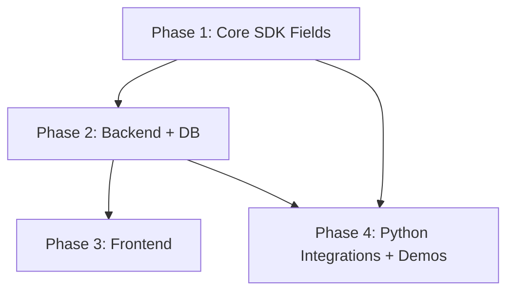

# EcoCode Python SDK — Feature Expansion Implementation Plan

## Goal

Add 13 features to the EcoCode Python SDK in a single coordinated effort spanning all 4 layers of the stack:
1. **Rust core** (PyO3 extension + ecocode-core crate)
2. **Backend** (Axum API + PostgreSQL schema)
3. **Frontend** (Next.js dashboard)
4. **Python integrations + demos**

---

## User Review Required

> [!IMPORTANT]
> **Custom metrics data model**: The plan uses a single `JSONB` column (`custom_metrics`) on the `records` table rather than creating a separate table. This keeps the insert path fast (one row per tick) and avoids N+1 queries. The trade-off is that you can't create indexes on individual custom metric keys. If you anticipate needing to query/filter by specific custom keys (e.g., "find all records where grad_norm > 5.0"), a separate `custom_metric_records(record_id, key, value)` table would be better. **Which approach do you prefer?**

> [!IMPORTANT]
> **Carbon estimation**: The plan includes adding `log_batch_size` and `log_gradient_norm` as dedicated fields. However, `log_custom("batch_size", 64)` could also serve this purpose once custom metrics are implemented. Do you want dedicated typed fields (faster queries, typed columns) or should these go through the generic `log_custom` path?

> [!WARNING]  
> **Jupyter widget**: The `ipywidgets` integration requires a separate `npm` build step for the JavaScript component. This adds ~200 lines of JS + the `jupyter nbextension` packaging. Should we defer this to a follow-up and focus on a simpler **Jupyter magic** approach (`%%ecocode`) first?

## Open Questions

1. **Axolotl YAML config injection**: Axolotl supports a `callbacks:` YAML field, but the exact API varies by version. Should the demo target Axolotl ≥ 0.4.0?
2. **ONNX Runtime**: Should we track per-operator energy (if profiling is enabled), or just overall `session.run()` latency + phase?
3. **Multi-GPU roles**: The current `gpu_records` table doesn't have a `role` column. Adding one requires a schema migration. Should we add it to `gpu_records` directly, or store it as metadata on the `run_system_info` table (one-time, not per-record)?

---

## Proposed Changes

The work is organized into **4 phases** in dependency order:



---

### Phase 1: Core SDK — New Fields & Methods (Rust)

These changes add the new metric fields to the sampler state, socket protocol, and PyO3 API surface.

---

#### [MODIFY] [sampler.rs](file:///home/mak/Desktop/ecocode/python-sdk/src/sampler.rs)

Add new fields to `MarkerState` and corresponding setter methods to `SamplerHandle`:

```diff
 struct MarkerState {
     phase: Option<String>,
     tokens_processed: Option<i64>,
     training_step: Option<i64>,
     loss: Option<f64>,
     learning_rate: Option<f64>,
     sequence_length: Option<i32>,
     accuracy: Option<f64>,
+    batch_size: Option<i32>,
+    gradient_norm: Option<f64>,
+    custom_metrics: Option<std::collections::HashMap<String, f64>>,
 }
```

Add setter methods:
- `set_batch_size(batch_size: i32)`
- `set_gradient_norm(norm: f64)`
- `set_custom_metric(key: String, value: f64)` — inserts into the HashMap, creates it if None

Update the `sampler_loop` record-building block to include the new fields when constructing the `Record` payload.

---

#### [MODIFY] [http_client.rs](file:///home/mak/Desktop/ecocode/ecocode/crates/core/src/http_client.rs)

Add new fields to the `Record` struct:

```diff
 pub struct Record {
     // ... existing fields ...
     pub accuracy: Option<f64>,
+    pub batch_size: Option<i32>,
+    pub gradient_norm: Option<f64>,
+    pub custom_metrics: Option<std::collections::HashMap<String, f64>>,
 }
```

No changes to the serialization — `serde` handles `HashMap` → JSON object automatically.

---

#### [MODIFY] [lib.rs](file:///home/mak/Desktop/ecocode/python-sdk/src/lib.rs)

Add 3 new `#[pymethods]` to `EcoCodeRun`:

**`log_batch_size(batch_size: i32)`** — same pattern as `log_sequence_length`:
```rust
fn log_batch_size(&self, batch_size: i32) {
    match &self.mode {
        Mode::Attached { .. } => {
            if let Some(ref socket) = self.socket {
                let event = serde_json::json!({"event": "batch_size", "value": batch_size});
                socket.send_event(&event);
            }
        }
        Mode::Standalone => {
            if let Some(ref sampler) = self.sampler {
                sampler.set_batch_size(batch_size);
            }
        }
    }
}
```

**`log_gradient_norm(norm: f64)`** — same pattern as `log_loss`.

**`log_custom(key: &str, value: f64)`** — routes to `sampler.set_custom_metric()` in standalone mode, sends `{"event": "custom", "key": key, "value": value}` in attached mode.

---

### Phase 2: Backend — Schema + API + Queries

---

#### [MODIFY] [schema.rs](file:///home/mak/Desktop/ecocode/web/backend/src/db/schema.rs)

Add 3 new `ALTER TABLE` migration statements after the existing accuracy migration (line 276):

```sql
ALTER TABLE records ADD COLUMN IF NOT EXISTS batch_size INT;
ALTER TABLE records ADD COLUMN IF NOT EXISTS gradient_norm DOUBLE PRECISION;
ALTER TABLE records ADD COLUMN IF NOT EXISTS custom_metrics JSONB;
```

---

#### [MODIFY] [ingest.rs (models)](file:///home/mak/Desktop/ecocode/web/backend/src/models/ingest.rs)

Add fields to `IngestRecordData`:

```diff
 pub struct IngestRecordData {
     // ... existing fields ...
     pub accuracy: Option<f64>,
+    pub batch_size: Option<i32>,
+    pub gradient_norm: Option<f64>,
+    pub custom_metrics: Option<serde_json::Value>,
 }
```

---

#### [MODIFY] [ingest.rs (api)](file:///home/mak/Desktop/ecocode/web/backend/src/api/ingest.rs)

Update the `INSERT INTO records` SQL to include the 3 new columns and bind them:

```diff
 "INSERT INTO records
-    (run_id, pid, timestamp, ..., accuracy)
- VALUES ($1, ..., $18)
+    (run_id, pid, timestamp, ..., accuracy, batch_size, gradient_norm, custom_metrics)
+ VALUES ($1, ..., $18, $19, $20, $21)
  RETURNING id",
```

Add `.bind(payload.batch_size)`, `.bind(payload.gradient_norm)`, `.bind(&payload.custom_metrics)`.

---

#### [MODIFY] [record.rs (models)](file:///home/mak/Desktop/ecocode/web/backend/src/models/record.rs)

Add fields to both `RecordPointRow` and `RecordPoint`:

```diff
 pub struct RecordPointRow {
     // ... existing fields ...
     pub accuracy: Option<f64>,
+    pub batch_size: Option<i32>,
+    pub gradient_norm: Option<f64>,
+    pub custom_metrics: Option<sqlx::types::JsonValue>,
 }
```

Same for `RecordPoint`.

---

#### [MODIFY] [records.rs (db)](file:///home/mak/Desktop/ecocode/web/backend/src/db/records.rs)

Update all 5 `SELECT` queries to include `batch_size, gradient_norm, custom_metrics` in the column list.

Update the `RecordPoint` construction blocks (lines 165-187, 231-253) to pass through the new fields.

---

### Phase 3: Frontend — Types + Charts

---

#### [MODIFY] [mock-data.ts](file:///home/mak/Desktop/ecocode/web/frontend/lib/mock-data.ts)

Add to `MetricRecord` interface:

```diff
 export interface MetricRecord {
   // ... existing fields ...
   accuracy?: number | null
+  batch_size?: number | null
+  gradient_norm?: number | null
+  custom_metrics?: Record<string, number> | null
 }
```

---

#### [MODIFY] [api-client.ts](file:///home/mak/Desktop/ecocode/web/frontend/lib/api-client.ts) and [client.ts](file:///home/mak/Desktop/ecocode/web/frontend/lib/api/client.ts)

Update the `mapRecord()` function to pass through the new fields from `BackendRecordPoint`.

---

#### [MODIFY] [TrainingMetricsChart.tsx](file:///home/mak/Desktop/ecocode/web/frontend/components/charts/TrainingMetricsChart.tsx)

Add `gradient_norm` as a new line series on the chart (left Y-axis, alongside loss). Add `batch_size` to the tooltip.

For `custom_metrics`: the chart doesn't need to render arbitrary custom keys — that's a future enhancement. For now, just ensure they pass through the data pipeline without breaking anything.

---

### Phase 4: Python Integrations + Demos

---

#### [NEW] [keras.py](file:///home/mak/Desktop/ecocode/python-sdk/ecocode/integrations/keras.py)

Keras 3 `Callback` integration. ~80 lines.

```python
"""
Keras / TensorFlow integration.

Usage:
    import ecocode
    from ecocode.integrations.keras import EcoCodeCallback

    with ecocode.run("keras-train", project_id=42, api_key="eco_...") as eco_run:
        model.fit(x, y, callbacks=[EcoCodeCallback(eco_run)])
"""
from __future__ import annotations
from typing import TYPE_CHECKING

if TYPE_CHECKING:
    from .. import EcoCodeRun

try:
    from keras.callbacks import Callback as _Base
except ImportError:
    try:
        from tensorflow.keras.callbacks import Callback as _Base
    except ImportError:
        _Base = object


class EcoCodeCallback(_Base):
    """
    Keras Callback that tracks training phases and metrics.

    Hooks:
      on_train_begin      → phase = "data_loading"
      on_epoch_begin      → log_epoch(epoch)
      on_train_batch_begin → phase = "forward"
      on_train_batch_end  → phase = "optimizer_step", log step + loss + lr + batch_size
      on_test_begin       → phase = "eval"
      on_train_end        → phase = "done"
    """

    def __init__(self, run: "EcoCodeRun") -> None:
        super().__init__()
        self._run = run
        self._global_step = 0

    def on_train_begin(self, logs=None):
        self._run.mark("phase", "data_loading")

    def on_epoch_begin(self, epoch, logs=None):
        self._run.log_epoch(epoch)

    def on_train_batch_begin(self, batch, logs=None):
        self._run.mark("phase", "forward")

    def on_train_batch_end(self, batch, logs=None):
        self._run.mark("phase", "optimizer_step")
        self._run.log_step(self._global_step)
        self._global_step += 1
        if logs:
            if "loss" in logs:
                self._run.log_loss(float(logs["loss"]))
            if "lr" in logs or "learning_rate" in logs:
                lr = logs.get("lr", logs.get("learning_rate"))
                if lr is not None:
                    self._run.log_lr(float(lr))
            if "accuracy" in logs or "acc" in logs:
                acc = logs.get("accuracy", logs.get("acc"))
                if acc is not None:
                    self._run.log_accuracy(float(acc) * 100)
            if "batch_size" in logs:
                self._run.log_batch_size(int(logs["batch_size"]))

    def on_test_begin(self, logs=None):
        self._run.mark("phase", "eval")

    def on_train_end(self, logs=None):
        self._run.mark("phase", "done")
```

---

#### [NEW] [onnxruntime.py](file:///home/mak/Desktop/ecocode/python-sdk/ecocode/integrations/onnxruntime.py)

ONNX Runtime `InferenceSession` wrapper. ~70 lines.

```python
"""
ONNX Runtime inference integration.

Usage:
    import ecocode
    from ecocode.integrations.onnxruntime import EcoCodeORTWrapper

    session = ort.InferenceSession("model.onnx")
    with ecocode.run("ort-inference", api_key="eco_...") as eco_run:
        eco_session = EcoCodeORTWrapper(session, eco_run)
        result = eco_session.run(None, {"input": data})
"""
from __future__ import annotations
from typing import TYPE_CHECKING, Optional, Any

if TYPE_CHECKING:
    from .. import EcoCodeRun


class EcoCodeORTWrapper:
    """
    Wrapper around onnxruntime.InferenceSession that marks inference phases.

    Tracks:
      model_load → prefill → done (per call to .run())
    """

    def __init__(self, session: Any, run: "EcoCodeRun") -> None:
        self._session = session
        self._run = run
        self._total_inferences = 0
        run.mark("phase", "model_load")

    def run(
        self,
        output_names: Optional[list] = None,
        input_feed: Optional[dict] = None,
        run_options: Any = None,
    ):
        """Wraps InferenceSession.run() with phase markers."""
        self._run.mark("phase", "prefill")
        self._total_inferences += 1
        self._run.log_step(self._total_inferences)

        # Estimate batch size from first input tensor
        if input_feed:
            first_val = next(iter(input_feed.values()), None)
            if first_val is not None and hasattr(first_val, "shape"):
                self._run.log_batch_size(int(first_val.shape[0]))

        result = self._session.run(output_names, input_feed, run_options)
        self._run.mark("phase", "done")
        return result

    def __getattr__(self, name):
        """Proxy all other attributes to the underlying session."""
        return getattr(self._session, name)
```

---

#### [NEW] [jupyter.py](file:///home/mak/Desktop/ecocode/python-sdk/ecocode/integrations/jupyter.py)

Jupyter magic for inline energy tracking. ~100 lines. Uses IPython display and HTML rendering (no ipywidgets build step).

```python
"""
Jupyter Notebook integration — %%ecocode cell magic + live energy display.

Usage (in a notebook cell):
    %load_ext ecocode.integrations.jupyter

Then:
    %%ecocode --api-key eco_... --project-id 42
    model.fit(x, y, epochs=10)

Or manual:
    from ecocode.integrations.jupyter import EcoCodeDisplay
    display = EcoCodeDisplay(eco_run)
    display.start()
    # ... training ...
    display.stop()  # prints final summary
"""
from __future__ import annotations
from typing import TYPE_CHECKING
import threading
import time

if TYPE_CHECKING:
    from .. import EcoCodeRun


class EcoCodeDisplay:
    """Inline HTML energy display for Jupyter notebooks."""

    def __init__(self, run: "EcoCodeRun", refresh_interval: float = 2.0) -> None:
        self._run = run
        self._interval = refresh_interval
        self._stop_event = threading.Event()
        self._thread = None
        self._display_handle = None

    def start(self):
        """Start the live display update loop."""
        from IPython.display import display, HTML
        self._display_handle = display(
            HTML(self._render_html("Starting...")), display_id=True
        )
        self._thread = threading.Thread(target=self._update_loop, daemon=True)
        self._thread.start()

    def stop(self):
        """Stop the display loop and show final summary."""
        self._stop_event.set()
        if self._thread:
            self._thread.join(timeout=5.0)
        if self._display_handle:
            from IPython.display import HTML
            self._display_handle.update(HTML(self._render_html("Finished")))

    def _update_loop(self):
        while not self._stop_event.wait(timeout=self._interval):
            if self._display_handle:
                from IPython.display import HTML
                self._display_handle.update(HTML(self._render_html("Running")))

    def _render_html(self, status: str) -> str:
        return f"""
        <div style="
            background: linear-gradient(135deg, #1a1a2e, #16213e);
            border-radius: 12px; padding: 16px 20px;
            font-family: 'Inter', sans-serif; color: #e0e0e0;
            border: 1px solid #2a2a4a; margin: 8px 0;
        ">
            <div style="display: flex; align-items: center; gap: 8px; margin-bottom: 8px;">
                <span style="font-size: 18px;">⚡</span>
                <span style="font-weight: 600; font-size: 14px;">EcoCode Energy Tracker</span>
                <span style="
                    background: {'#22c55e' if status == 'Running' else '#6b7280'};
                    color: white; font-size: 10px; padding: 2px 8px;
                    border-radius: 9999px; font-weight: 500;
                ">{status}</span>
            </div>
            <div style="font-size: 12px; color: #9ca3af;">
                Run: {getattr(self._run, 'name', 'unknown')} |
                Interval: {getattr(self._run, 'interval', '?')}s
            </div>
        </div>
        """


def load_ipython_extension(ipython):
    """Register the %%ecocode cell magic."""
    from IPython.core.magic import register_cell_magic
    import ecocode

    @register_cell_magic
    def ecocode_magic(line, cell):
        import argparse
        parser = argparse.ArgumentParser()
        parser.add_argument("--api-key", required=True)
        parser.add_argument("--project-id", type=int, default=None)
        parser.add_argument("--name", default="notebook-cell")
        args = parser.parse_args(line.split())

        with ecocode.run(args.name, api_key=args.api_key, project_id=args.project_id) as run:
            display = EcoCodeDisplay(run)
            display.start()
            try:
                ipython.run_cell(cell)
            finally:
                display.stop()

    ipython.register_magic_function(ecocode_magic, magic_kind="cell", magic_name="ecocode")
```

---

#### [NEW] [demo_keras.py](file:///home/mak/Desktop/ecocode/python-sdk/demo_keras.py)

Keras demo training a small CNN on MNIST. ~60 lines. Shows `EcoCodeCallback` usage with `model.fit()`.

---

#### [NEW] [demo_axolotl.py](file:///home/mak/Desktop/ecocode/python-sdk/demo_axolotl.py)

Demonstrates that the existing `EcoCodeCallback` works with Axolotl by injecting it via Axolotl's callback system. ~40 lines + a companion `axolotl_config.yml` showing the YAML configuration.

Key approach:
```python
# Axolotl uses HuggingFace Trainer internally, so our callback just works:
from ecocode.integrations.huggingface import EcoCodeCallback

# In axolotl's train() function, callbacks are passed through:
# axolotl.train(cfg, callbacks=[EcoCodeCallback(eco_run)])
```

---

#### [NEW] [demo_unsloth.py](file:///home/mak/Desktop/ecocode/python-sdk/demo_unsloth.py)

Demonstrates Unsloth + EcoCode integration. ~50 lines. Shows that `EcoCodeSFTCallback` works directly because Unsloth patches HuggingFace's SFTTrainer:

```python
from unsloth import FastLanguageModel
from trl import SFTTrainer
from ecocode.integrations.trl import EcoCodeSFTCallback

# Unsloth patches SFTTrainer transparently — our callback works unchanged
trainer = SFTTrainer(
    model=model,
    callbacks=[EcoCodeSFTCallback(eco_run)],
    ...
)
```

---

#### [NEW] [demo_onnxruntime.py](file:///home/mak/Desktop/ecocode/python-sdk/demo_onnxruntime.py)

ONNX Runtime inference demo. ~50 lines. Exports a small PyTorch model to ONNX, then runs inference with `EcoCodeORTWrapper`.

---

#### [MODIFY] [__init__.py (integrations)](file:///home/mak/Desktop/ecocode/python-sdk/ecocode/integrations/__init__.py)

Add comments for the new integrations:

```diff
 #   from ecocode.integrations.vllm import EcoCodeVLLMMiddleware
+#   from ecocode.integrations.keras import EcoCodeCallback
+#   from ecocode.integrations.onnxruntime import EcoCodeORTWrapper
+#   from ecocode.integrations.jupyter import EcoCodeDisplay
```

---

#### [MODIFY] [pyproject.toml](file:///home/mak/Desktop/ecocode/python-sdk/pyproject.toml)

Add new optional dependency groups:

```diff
 [project.optional-dependencies]
 hf        = ["transformers>=4.30.0"]
 trl       = ["trl>=0.7.0"]
 lightning = ["pytorch-lightning>=2.0.0"]
+keras     = ["keras>=3.0.0"]
+onnx      = ["onnxruntime>=1.16.0"]
+jupyter   = ["ipython>=7.0.0"]
-all       = ["transformers>=4.30.0", "trl>=0.7.0"]
+all       = ["transformers>=4.30.0", "trl>=0.7.0", "keras>=3.0.0", "onnxruntime>=1.16.0"]
 dev       = ["pytest>=7.0.0", "pytest-mock>=3.0.0", "responses>=0.25.0"]
```

---

#### [MODIFY] [__init__.py (root)](file:///home/mak/Desktop/ecocode/python-sdk/ecocode/__init__.py)

Update the module docstring to document the new methods:

```diff
 ML Phase labels (use these consistently for cross-run comparisons):
   Pretraining / SFT : data_loading, tokenization, forward, backward,
                       optimizer_step, eval, checkpoint_save, done
   RLHF              : reward_model, policy_rollout, reference_forward,
                       ppo_update, dpo_update, grpo_update, kl_penalty
   Inference         : model_load, prefill, decode, kv_cache_ops, done
+
+Additional methods:
+  run.log_batch_size(n)         — Track batch size per step
+  run.log_gradient_norm(norm)   — Track gradient L2 norm
+  run.log_custom(key, value)    — Log arbitrary numeric metrics
```

---

#### [MODIFY] [README.md](file:///home/mak/Desktop/ecocode/python-sdk/README.md)

Add documentation sections for:
- New Available Methods table entries (`log_batch_size`, `log_gradient_norm`, `log_custom`)
- New Integration sections (Keras, ONNX Runtime, Jupyter)
- New demo descriptions (Axolotl, Unsloth)

---

## Summary of All Files Changed

| Layer | File | Action | Description |
|-------|------|--------|-------------|
| **Rust Core** | `python-sdk/src/sampler.rs` | MODIFY | Add `batch_size`, `gradient_norm`, `custom_metrics` to `MarkerState` + setters |
| **Rust Core** | `python-sdk/src/lib.rs` | MODIFY | Add `log_batch_size`, `log_gradient_norm`, `log_custom` pymethods |
| **Rust Core** | `ecocode/crates/core/src/http_client.rs` | MODIFY | Add 3 fields to `Record` struct |
| **Backend** | `web/backend/src/db/schema.rs` | MODIFY | 3 `ALTER TABLE` migrations |
| **Backend** | `web/backend/src/models/ingest.rs` | MODIFY | 3 fields on `IngestRecordData` |
| **Backend** | `web/backend/src/models/record.rs` | MODIFY | 3 fields on `RecordPointRow` + `RecordPoint` |
| **Backend** | `web/backend/src/api/ingest.rs` | MODIFY | Update INSERT SQL + bindings |
| **Backend** | `web/backend/src/db/records.rs` | MODIFY | Update 5 SELECT queries + construction blocks |
| **Frontend** | `web/frontend/lib/mock-data.ts` | MODIFY | 3 fields on `MetricRecord` |
| **Frontend** | `web/frontend/lib/api-client.ts` | MODIFY | Update `mapRecord()` |
| **Frontend** | `web/frontend/lib/api/client.ts` | MODIFY | Update `mapRecord()` |
| **Frontend** | `web/frontend/components/charts/TrainingMetricsChart.tsx` | MODIFY | Add gradient_norm line |
| **Python** | `python-sdk/ecocode/integrations/keras.py` | NEW | Keras callback (~80 lines) |
| **Python** | `python-sdk/ecocode/integrations/onnxruntime.py` | NEW | ONNX Runtime wrapper (~70 lines) |
| **Python** | `python-sdk/ecocode/integrations/jupyter.py` | NEW | Jupyter magic + display (~100 lines) |
| **Python** | `python-sdk/ecocode/integrations/__init__.py` | MODIFY | Add import comments |
| **Python** | `python-sdk/ecocode/__init__.py` | MODIFY | Update docstring |
| **Python** | `python-sdk/pyproject.toml` | MODIFY | Add optional deps |
| **Python** | `python-sdk/demo_keras.py` | NEW | Keras demo (~60 lines) |
| **Python** | `python-sdk/demo_axolotl.py` | NEW | Axolotl demo (~40 lines) |
| **Python** | `python-sdk/demo_unsloth.py` | NEW | Unsloth demo (~50 lines) |
| **Python** | `python-sdk/demo_onnxruntime.py` | NEW | ONNX Runtime demo (~50 lines) |
| **Python** | `python-sdk/README.md` | MODIFY | Document all new features |

**Total: 23 files** (9 new, 14 modified)

---

## Verification Plan

### Automated Tests

1. **Rust compilation**: `cd python-sdk && maturin develop --release` — verifies the PyO3 extension compiles with new fields.
2. **Backend compilation**: `cd web/backend && cargo build` — verifies schema, models, and API compile.
3. **Existing test suite**: `cd python-sdk && python -m pytest test_sdk.py` — ensures no regressions.
4. **Frontend type-check**: `cd web/frontend && npx tsc --noEmit` — verifies TypeScript types are consistent.
5. **Integration test**: Run `demo_keras.py` (if Keras is installed) and verify records appear in the database with the new fields populated.

### Manual Verification

1. Run `demo_training.py` with `log_custom("grad_norm", 1.5)` calls added — verify `custom_metrics` JSON appears in the `records` table.
2. Open the dashboard and verify the TrainingMetricsChart renders `gradient_norm` as a line.
3. Load the Jupyter integration in a notebook and verify the HTML widget renders.
