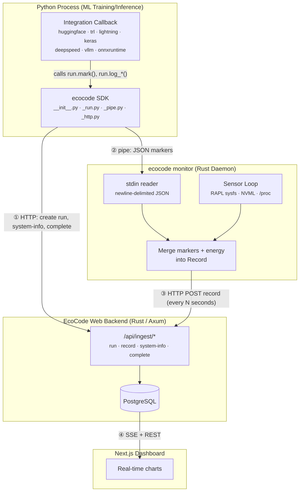
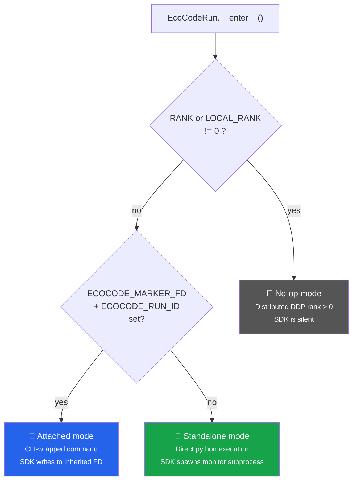

# EcoCode Python SDK — Complete Architectural Analysis

The **EcoCode Python SDK** is a lightweight, zero-dependency Python instrumentation library designed to track energy consumption (CPU, GPU, and RAM) in machine learning training and inference workloads. Rather than implementing native hardware monitoring itself, it acts as a semantic event coordinator, delegating low-level sensor readings to the **`ecocode` Rust CLI binary** to remain safe, fast, and fully fork-safe.

---

## 1. System Architecture & Flow

The following diagram illustrates how the Python SDK interacts with the Rust headless monitor, the web backend, and the visualization dashboard:

### Telemetry Pipeline
1. **Lifecycle Requests (①)**: The SDK calls the backend to create runs and register system properties using standard `urllib` calls.
2. **Semantic Markers (②)**: The training callback writes markers (e.g. `phase`, `loss`, `learning_rate`) into a Unix pipe.
3. **Sensor Integration (③)**: The Rust monitor subprocess samples hardware stats, merges them with the latest parsed markers, and POSTs records to the backend.
4. **Real-time Rendering (④)**: The backend serves aggregated data to the Next.js UI using Server-Sent Events.

---

## 2. Operation Modes

The SDK detects its execution environment inside [`EcoCodeRun.__enter__`](../../python-sdk/ecocode/_run.py#L98-L236) to select the appropriate mode of operation:

### 1. Standalone Mode (Direct Execution)
Used when running a Python script directly (`python train.py`). 
* The SDK registers a new run and submits host machine metadata.
* It resolves the path of the `ecocode` executable and starts it as a background subprocess using `subprocess.Popen("ecocode monitor --run-id <run_id> --pid <python_pid>")`.
* Markers are sent over `stdin` using [`PipeWriter`](../../python-sdk/ecocode/_pipe.py#L10-L29).

### 2. Attached Mode (CLI Wrapper)
Used when running under the CLI (`ecocode run -- python train.py`).
* The parent CLI process manages run registration and spawns the Python process.
* The SDK detects `ECOCODE_RUN_ID` and `ECOCODE_MARKER_FD`.
* It routes telemetry output to the inherited file descriptor using [`InheritedFdWriter`](../../python-sdk/ecocode/_pipe.py#L31-L56). No extra API calls or subprocesses are initiated by Python.

### 3. No-Op Mode (Multi-GPU DDP)
Triggered when running multi-GPU setups.
* To prevent duplicate run registrations and redundant monitoring, any process where `RANK` or `LOCAL_RANK` is non-zero routes all commands to [`NullWriter`](../../python-sdk/ecocode/_pipe.py#L58-L65).

---

## 3. Core Modules & Code Mapping

The Python SDK is structured across five key files inside the [ecocode/](../../python-sdk/ecocode) directory:

### Public Interface: [__init__.py](../../python-sdk/ecocode/__init__.py)
Exposes public entrypoints for user interaction:
* **[run](../../python-sdk/ecocode/__init__.py#L59-L83)**: Context manager factory.
* **[track](../../python-sdk/ecocode/__init__.py#L86-L118)**: Decorator to wrap complete function scopes.

### Core Orchestrator: [_run.py](../../python-sdk/ecocode/_run.py)
Implements the main lifecycle logic inside [`EcoCodeRun`](../../python-sdk/ecocode/_run.py#L65-L298):
* **[`__enter__`](../../python-sdk/ecocode/_run.py#L98-L236)**: Resolves environments, requests run registration, performs security check on the Rust binary path, and launches the monitor.
* **[`__exit__`](../../python-sdk/ecocode/_run.py#L237-L259)**: Closes communication pipes, terminates the daemon process, and reports the run status (`finished` or `failed`).
* **[`_collect_system_info`](../../python-sdk/ecocode/_run.py#L300-L345)**: Parses `/proc/meminfo` and queries `nvidia-smi` to fetch target machine info.
* **[`_sanitize_command`](../../python-sdk/ecocode/_run.py#L368-L396)**: Strips credentials (e.g. `--api-key`, `--token`, `--passwd`) from startup command parameters to prevent credential exposure.

### Communication Channels: [_pipe.py](../../python-sdk/ecocode/_pipe.py)
Manages the physical transport of serialized NDJSON event packets.
* **[`PipeWriter`](../../python-sdk/ecocode/_pipe.py#L10-L29)**: Forwards events to the child monitor stdin.
* **[`InheritedFdWriter`](../../python-sdk/ecocode/_pipe.py#L31-L56)**: Sends data through CLI-inherited pipes.
* **[`NullWriter`](../../python-sdk/ecocode/_pipe.py#L58-L65)**: Silently discards markers on non-zero ranks.

### HTTP Client: [_http.py](../../python-sdk/ecocode/_http.py)
A standard-library-only implementation of [`EcoCodeHTTPClient`](../../python-sdk/ecocode/_http.py#L20-L92) to keep the SDK free of external dependencies (e.g., `requests` or `urllib3`):
* Enforces HTTPS for all remote communication to keep credentials secure.
* Restricts response reads to `1 MiB` to mitigate memory exhaustion vectors.

### Security & Input Validation: [_validation.py](../../python-sdk/ecocode/_validation.py)
Implements input sanitization checks that fail loudly to block invalid configurations before execution:
* **[`validate_api_key`](../../python-sdk/ecocode/_validation.py#L30-L64)**: Checks credentials against expected formats to block injection.
* **[`validate_base_url`](../../python-sdk/ecocode/_validation.py#L75-L131)**: Permits only `http` (restricted to localhost) and `https` schemes.
* **[`validate_run_id`](../../python-sdk/ecocode/_validation.py#L141-L180)**: Validates numeric ranges.
* **[`validate_marker_fd`](../../python-sdk/ecocode/_validation.py#L188-L232)**: Prevents using standard streams (FD $\le 2$) and checks that descriptors are valid.

---

## 4. ML Framework Integrations

The SDK contains custom integrations under [ecocode/integrations/](../../python-sdk/ecocode/integrations) that listen to specific training loops and output markers automatically:

1. **Hugging Face Callback ([huggingface.py](../../python-sdk/ecocode/integrations/huggingface.py))**: Implements [`EcoCodeCallback`](../../python-sdk/ecocode/integrations/huggingface.py#L33). Emits phases (`forward`, `optimizer_step`, `eval`, `checkpoint_save`) and registers step numbers, sequence lengths, loss, and learning rate.
2. **TRL Callbacks ([trl.py](../../python-sdk/ecocode/integrations/trl.py))**: Since different alignment techniques use different computational flows, this contains:
   * [`EcoCodeSFTCallback`](../../python-sdk/ecocode/integrations/trl.py#L38) (Supervised Fine-Tuning)
   * [`EcoCodeDPOCallback`](../../python-sdk/ecocode/integrations/trl.py#L84) (Direct Preference Optimization)
   * [`EcoCodeGRPOCallback`](../../python-sdk/ecocode/integrations/trl.py#L131) (Group Relative Policy Optimization - separates generation/rollouts from gradient updates)
3. **vLLM Inference Middleware ([vllm.py](../../python-sdk/ecocode/integrations/vllm.py))**: Tracks prefill and decoding phases separately to optimize serving benchmarks.
4. **Other Integrations**:
   * [lightning.py](../../python-sdk/ecocode/integrations/lightning.py) (PyTorch Lightning callback)
   * [deepspeed.py](../../python-sdk/ecocode/integrations/deepspeed.py) (Manual helper for DeepSpeed engine loops)
   * [keras.py](../../python-sdk/ecocode/integrations/keras.py) (Keras 3 callback)
   * [onnxruntime.py](../../python-sdk/ecocode/integrations/onnxruntime.py) (Session wrapper for ONNX inference sessions)
