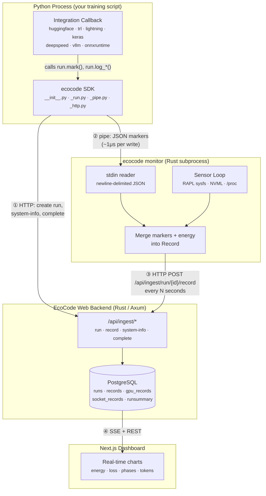
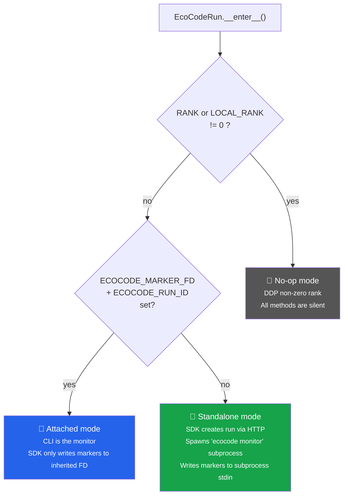
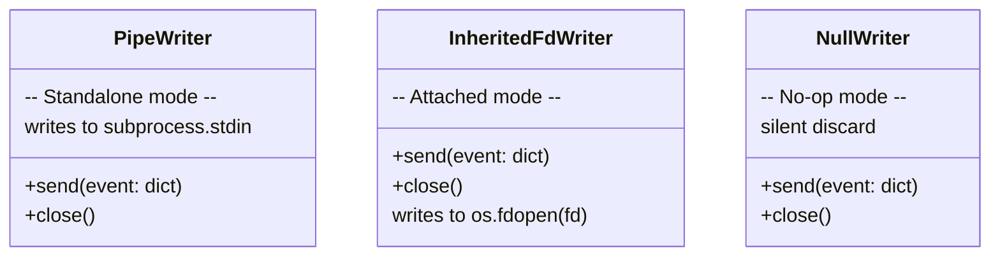
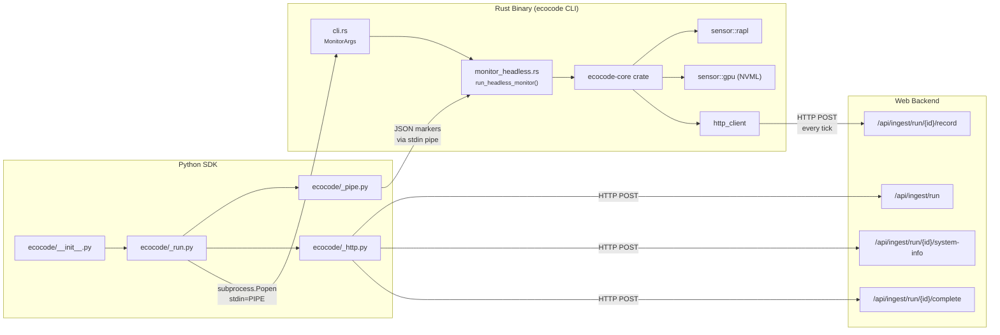
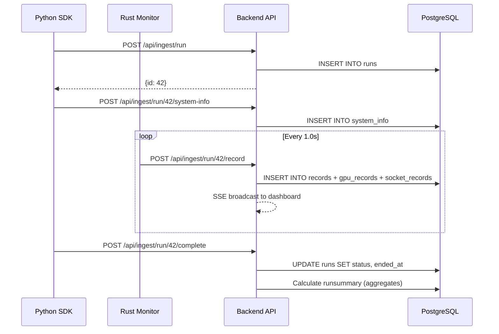
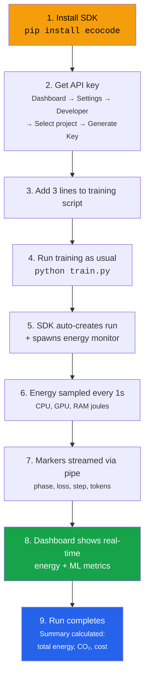
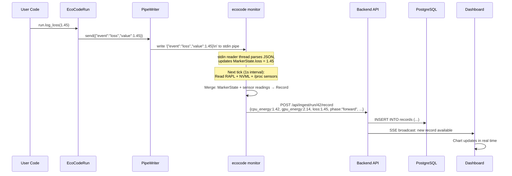

# EcoCode Python SDK — Complete Analysis

## 1. What Is the Python SDK?

The EcoCode Python SDK is a **pure-Python instrumentation library** (zero compiled dependencies) that lets ML researchers and engineers measure the **real energy consumption** (CPU, GPU, RAM) of their training and inference runs. It sends structured telemetry — energy readings + semantic ML markers (phase, loss, step, tokens, etc.) — to the EcoCode web backend, where a dashboard visualises everything in real time.

> [!IMPORTANT]
> The SDK itself does **not** read hardware sensors. It delegates all energy measurement to the **`ecocode` Rust CLI binary**, which it either spawns as a subprocess (standalone mode) or communicates with via an inherited pipe (attached mode). The Python process has **zero native threads**, making it fully fork-safe for DataLoader workers and DDP.

---

## 2. Big-Picture Architecture



### The four numbered arrows are the complete data path:

| # | What | From → To | Protocol |
|---|------|-----------|----------|
| ① | Run lifecycle (create, complete, system-info) | SDK → Backend | HTTP POST (stdlib `urllib`) |
| ② | Semantic markers (phase, loss, step, tokens…) | SDK → Monitor subprocess | Unix pipe (stdin), NDJSON |
| ③ | Combined energy + marker records | Monitor → Backend | HTTP POST (`ecocode-core` client) |
| ④ | Visualisation data | Backend → Dashboard | REST + SSE (Server-Sent Events) |

---

## 3. The Two Operating Modes

The SDK has two mutually exclusive modes, **auto-detected** when you call `__enter__()` (or `.start()`):



### 3.1 Standalone Mode — Step by Step

This is the most common mode. The user runs their script directly:

```
python train.py
```

**What happens internally:**

```
 Python script                    ecocode monitor subprocess        EcoCode backend
 ───────────────────────────────────────────────────────────────────────────────────
 ecocode.run().__enter__()
   │
   ├─ POST /api/ingest/run  ──────────────────────────────────────► creates run row
   │   body: {project_id, name, started_at, command, exporter_type: "sdk"}
   │   response: {id: 42}
   │
   ├─ POST /api/ingest/run/42/system-info  ───────────────────────► stores CPU/GPU info
   │   body: {cpu_name, cpu_cores, ram_gb, gpu_count, gpu_names}
   │
   ├─ subprocess.Popen("ecocode monitor --run-id 42 --pid $$", stdin=PIPE)
   │                                   │
   │                                   │  monitor subprocess (every 1.0s):
   │                                   ├─ NVML: GPU energy + utilisation
   │                                   ├─ /proc/[pid]/stat: CPU ticks → CPU %
   │                                   ├─ /proc/[pid]/smaps_rollup: PSS memory
   │                                   ├─ RAPL sysfs: CPU + DRAM + iGPU energy (J)
   │                                   ├─ read latest markers from stdin pipe
   │                                   └─ POST /api/ingest/run/42/record ─────────► stores record row
   │
 run.mark("phase", "forward")    ← writes {"event":"phase","value":"forward"}\n to pipe (~1μs)
 run.log_step(100)               ← writes {"event":"step","value":100}\n to pipe
 run.log_loss(1.45)              ← writes {"event":"loss","value":1.45}\n to pipe
   │
 ecocode.run().__exit__()
   ├─ pipe.close()               ← EOF signal → monitor flushes final record, exits
   ├─ waitpid(timeout=10s)       ← waits for subprocess to finish
   └─ POST /api/ingest/run/42/complete ───────────────────────────► marks run finished/failed
       body: {status: "finished", ended_at: "..."}
```

**Key design decisions in standalone mode:**

- The SDK makes only **3 HTTP calls** total (create, system-info, complete). All per-tick record reporting is done by the Rust subprocess.
- The Rust subprocess is a **separate OS process**, not a thread. This means the Python process has zero native threads, which is critical for `os.fork()` safety (PyTorch DataLoader, DDP).
- If the pipe breaks (monitor crashes), all `log_*` calls silently no-op via `BrokenPipeError` handling in [_pipe.py](../python-sdk/ecocode/_pipe.py).

### 3.2 Attached Mode — Step by Step

The user wraps their script with the CLI:

```bash
ecocode run -o online --api-key eco_... -- python train.py
```

**What happens internally:**

```
 CLI (Rust)                       Python script              EcoCode backend
 ──────────────────────────────────────────────────────────────────────────────
 ecocode run starts
   ├─ POST /api/ingest/run ────────────────────────────────► creates run
   ├─ creates OS pipe (read_fd, write_fd)
   ├─ env: ECOCODE_MARKER_FD=<write_fd>
   ├─ env: ECOCODE_RUN_ID=42
   └─ exec python train.py
                                  ecocode.run().__enter__()
                                    ├─ detects ECOCODE_MARKER_FD + ECOCODE_RUN_ID
                                    ├─ self._mode = "attached"
                                    └─ self._pipe = InheritedFdWriter(fd)
                                        (no HTTP calls, no subprocess)

                                  run.mark("phase", "forward")
                                    └─ pipe.write({"event":"phase","value":"forward"}\n)

 CLI reads marker from pipe ────►
   └─ merges marker into next energy record → POST to backend

                                  ecocode.run().__exit__()
                                    └─ pipe.close()

 CLI detects EOF, marks run "finished" / "canceled" / "failed"
```

**Key differences from standalone:**
- **No subprocess spawned from Python** — the CLI _is_ the monitor.
- **No HTTP calls from Python** — the SDK only writes to the inherited pipe FD.
- The CLI can detect Ctrl+C (SIGINT) and mark the run `"canceled"` — standalone mode can only produce `"finished"` or `"failed"`.

---

## 4. Module-by-Module Breakdown

### 4.1 [__init__.py](../python-sdk/ecocode/__init__.py) — Public API

Exposes three symbols:

| Symbol | Type | Purpose |
|--------|------|---------|
| `ecocode.run(name, *, api_key, project_id, base_url, interval)` | Factory → `EcoCodeRun` | Returns a context manager / startable run object |
| `ecocode.track(name, *, ...)` | Decorator factory | Wraps a function in an `EcoCodeRun` context |
| `EcoCodeRun` | Class | Re-exported for type hints |

`track()` is pure sugar:

```python
@ecocode.track("my-run", api_key="eco_...")
def train():
    ...

# Equivalent to:
def train():
    with ecocode.run("my-run", api_key="eco_..."):
        ...
```

### 4.2 [_run.py](../python-sdk/ecocode/_run.py) — Core `EcoCodeRun` Class

This is the heart of the SDK. It manages:

**Construction** (line 37–57): Stores config, sets up defaults. Falls back to `ECOCODE_API_KEY` and `ECOCODE_API_URL` environment variables.

**`__enter__()` / `start()`** (line 61–125):
1. **DDP rank check** — if `RANK` or `LOCAL_RANK` is set and != 0, enters no-op mode (all methods become silent).
2. **Attached mode detection** — if `ECOCODE_RUN_ID` and `ECOCODE_MARKER_FD` are set, opens the inherited FD as the pipe writer. No HTTP, no subprocess.
3. **Standalone mode** — creates the run via HTTP, collects system info, spawns `ecocode monitor` as a subprocess, connects its stdin as the pipe.

**`__exit__()` / `stop()`** (line 127–148):
1. Closes the pipe (signals EOF to the monitor).
2. Waits for the subprocess to exit (10s timeout, then SIGKILL).
3. In standalone mode, marks the run `"finished"` or `"failed"` via HTTP.
4. **Never suppresses exceptions** — returns `False` so training errors propagate normally.

**Marker API** (line 162–187): All `mark()`, `log_epoch()`, `log_step()`, `log_tokens()`, `log_loss()`, `log_lr()`, `log_sequence_length()`, `log_accuracy()`, `log_custom()` methods simply serialize a JSON event and write it to the pipe.

### 4.3 [_pipe.py](../python-sdk/ecocode/_pipe.py) — IPC Writers

Three implementations of the same interface:



All writers:
- Serialize events as `json.dumps(event) + "\n"` (newline-delimited JSON)
- Silently catch `BrokenPipeError` and `OSError` — if the monitor crashes, training continues unaffected

### 4.4 [_http.py](../python-sdk/ecocode/_http.py) — HTTP Client

A minimal blocking HTTP client using **only stdlib** (`urllib.request`). Zero external dependencies. Used only for run lifecycle:

| Method | Endpoint | When |
|--------|----------|------|
| `create_run()` | `POST /api/ingest/run` | `__enter__()` in standalone mode |
| `save_system_info()` | `POST /api/ingest/run/{id}/system-info` | `__enter__()` in standalone mode |
| `complete_run()` | `POST /api/ingest/run/{id}/complete` | `__exit__()` in standalone mode |

> [!NOTE]
> Per-tick energy record reporting is **not** done by this client. It's handled by the Rust monitor subprocess using `ecocode-core`'s `EcoCodeHttpClient`.

---

## 5. How the SDK Connects to EcoCode Core

### 5.1 The Connection Chain



### 5.2 The Rust Monitor Subprocess ([monitor_headless.rs](../ecocode/src/monitor_headless.rs))

When the SDK spawns `ecocode monitor --run-id 42 --pid 12345 --interval 1.0`, this Rust binary:

1. **Starts a stdin reader thread** (line 100–151) that parses NDJSON markers and updates a shared `MarkerState`:
   - `{"event":"phase","value":"forward"}` → sets `current_phase`
   - `{"event":"step","value":100}` → sets `training_step`
   - `{"event":"loss","value":1.45}` → sets `loss`
   - `{"event":"tokens","count":50000}` → sets `tokens_processed`
   - `{"event":"learning_rate","value":0.0003}` → sets `learning_rate`
   - `{"event":"sequence_length","value":2048}` → sets `sequence_length`

2. **Runs a sensor sampling loop** (line 196–382) at the configured interval:
   - Reads RAPL sysfs for CPU + DRAM + iGPU energy (joules)
   - Reads NVML for GPU energy and per-process utilisation
   - Reads `/proc/[pid]/stat` for CPU ticks and `/proc/[pid]/smaps_rollup` for PSS memory
   - Walks the full process tree (child processes) for accurate attribution

3. **Merges markers + energy** into a single `Record` struct and POSTs it to `/api/ingest/run/{id}/record`

4. **Exits** when stdin is closed (pipe EOF from SDK) or the target PID dies

### 5.3 The Backend Ingestion Flow ([ingest.rs](../web/backend/src/api/ingest.rs))

The backend exposes four ingestion endpoints:



---

## 6. Framework Integrations

All integrations follow the same pattern: they **wrap the framework's callback/hook system** and translate lifecycle events into `run.mark()` / `run.log_*()` calls. They are **lazily imported** — no `ImportError` if you don't have the framework installed.

### Integration Architecture Pattern

```mermaid
flowchart LR
    Framework["ML Framework<br/><small>Trainer / Lightning / Keras</small>"]
    Callback["EcoCode Callback<br/><small>translates hooks → markers</small>"]
    Run["EcoCodeRun<br/><small>run.mark(), run.log_*()</small>"]
    Pipe["Pipe Writer<br/><small>JSON → subprocess stdin</small>"]
    Monitor["ecocode monitor<br/><small>merges with energy data</small>"]

    Framework -->|"on_step_begin<br/>on_optimizer_step<br/>on_train_end"| Callback
    Callback -->|"mark('phase', 'forward')<br/>log_loss(1.45)<br/>log_step(100)"| Run
    Run -->|"JSON event"| Pipe
    Pipe -->|"stdin"| Monitor
```



### 6.1 [HuggingFace Transformers](../python-sdk/ecocode/integrations/huggingface.py)

Extends `TrainerCallback`. Works with `Trainer` and `SFTTrainer`.

```python
from ecocode.integrations.huggingface import EcoCodeCallback

with ecocode.run("sft-llama3", api_key="eco_...") as eco_run:
    trainer = Trainer(model=model, args=args, callbacks=[EcoCodeCallback(eco_run)])
    trainer.train()
```

**Lifecycle mapping:**

| Trainer Hook | → Phase | Extra Logging |
|---|---|---|
| `on_train_begin` | `data_loading` | `sequence_length` if available |
| `on_epoch_begin` | — | `log_epoch(epoch)` |
| `on_step_begin` | `forward` | — |
| `on_optimizer_step` | `optimizer_step` | `step`, `loss`, `lr` from log history |
| `on_evaluate` | `eval` | — |
| `on_save` | `checkpoint_save` | — |
| `on_train_end` | `done` | `tokens` from `num_input_tokens_seen` |

### 6.2 [TRL (SFT / DPO / GRPO)](../python-sdk/ecocode/integrations/trl.py)

Three separate callbacks because each alignment paradigm has a **fundamentally different energy profile**:

| Callback | Trainer | Key Difference |
|----------|---------|----------------|
| `EcoCodeSFTCallback` | `SFTTrainer` | Standard: forward → backward → optimizer_step |
| `EcoCodeDPOCallback` | `DPOTrainer` | Step runs **policy + reference forward** together (~2× energy), then `dpo_update` |
| `EcoCodeGRPOCallback` | `GRPOTrainer` | Step begins with `policy_rollout` (generation), then `grpo_update` (gradient) |

```python
# DPO example
from ecocode.integrations.trl import EcoCodeDPOCallback

with ecocode.run("dpo-run", api_key="eco_...") as eco_run:
    trainer = DPOTrainer(model=model, args=args, callbacks=[EcoCodeDPOCallback(eco_run)])
    trainer.train()
```

### 6.3 [PyTorch Lightning](../python-sdk/ecocode/integrations/lightning.py)

Extends `pytorch_lightning.callbacks.Callback`:

```python
from ecocode.integrations.lightning import EcoCodeCallback

with ecocode.run("pretrain", api_key="eco_...") as eco_run:
    trainer = pl.Trainer(callbacks=[EcoCodeCallback(eco_run)])
    trainer.fit(model, datamodule=dm)
```

Pulls loss from `trainer.callback_metrics` and LR from optimizer param groups.

### 6.4 [DeepSpeed](../python-sdk/ecocode/integrations/deepspeed.py)

**Manual hook object** (DeepSpeed has no TrainerCallback protocol). You call hooks explicitly:

```python
from ecocode.integrations.deepspeed import EcoCodeDeepSpeedCallback

with ecocode.run("pretrain-70b", api_key="eco_...") as eco_run:
    ds_cb = EcoCodeDeepSpeedCallback(eco_run, zero_stage=3)
    # → immediately marks phase "deepspeed_zero3_init"

    for step, batch in enumerate(loader):
        ds_cb.on_step_begin(step)           # phase = "forward"
        outputs = engine(batch)
        ds_cb.on_backward_begin()           # phase = "backward"
        engine.backward(outputs.loss)
        engine.step()
        ds_cb.on_optimizer_step(step, loss)  # phase = "optimizer_step"

    ds_cb.on_train_end()                    # phase = "done"
```

The `zero_stage` is logged as a one-time marker so the dashboard can compare communication overhead across ZeRO stages 0–3.

### 6.5 [vLLM Inference](../python-sdk/ecocode/integrations/vllm.py)

Two helpers:

**`EcoCodeVLLMMiddleware`** — wraps `AsyncLLMEngine.generate()`:
```python
eco_engine = EcoCodeVLLMMiddleware(engine, eco_run)
async for output in eco_engine.generate(prompt, params, request_id):
    yield output
# Automatically marks: prefill → decode, logs token counts
```

**`InferencePhaseTracker`** — for any inference loop:
```python
tracker = InferencePhaseTracker(eco_run)
tracker.on_model_load()                        # phase = "model_load"
tracker.on_prefill_begin(prompt_tokens=1024)   # phase = "prefill"
tracker.on_decode_begin()                      # phase = "decode"
tracker.on_generation_end(total_tokens=1124)   # logs tokens
```

> [!TIP]
> **Why track prefill vs decode separately?** Prefill is compute-bound (energy ∝ prompt_length²). Decode is memory-bandwidth-bound (energy per token is much lower). Knowing the split helps optimise prompt length and batching strategies.

### 6.6 [Keras / TensorFlow](../python-sdk/ecocode/integrations/keras.py)

Extends `keras.callbacks.Callback` (with fallback to `tf.keras`):
```python
from ecocode.integrations.keras import EcoCodeCallback

with ecocode.run("keras-train", api_key="eco_...") as eco_run:
    model.fit(x, y, callbacks=[EcoCodeCallback(eco_run)])
```

**Bonus:** Automatically forwards any **unknown numeric metrics** from Keras `logs` through `log_custom()` — custom Keras metrics (precision, recall, etc.) are tracked with zero extra code.

### 6.7 [ONNX Runtime](../python-sdk/ecocode/integrations/onnxruntime.py)

Wraps `onnxruntime.InferenceSession`:
```python
from ecocode.integrations.onnxruntime import EcoCodeORTWrapper

session = ort.InferenceSession("model.onnx")
with ecocode.run("ort-inference", api_key="eco_...") as eco_run:
    eco_session = EcoCodeORTWrapper(session, eco_run)
    result = eco_session.run(None, {"input": data})
```

Per `.run()` call: marks `model_load` → `prefill` → `done`, logs `batch_size`, `latency_ms`, and step count. Proxies all other attributes to the underlying session.

---

## 7. How Users Are Expected to Use It

### 7.1 The Three Usage Patterns

```mermaid
flowchart TD
    subgraph ContextManager["① Context Manager (recommended)"]
        CM1["with ecocode.run('name', api_key='...') as run:"]
        CM2["    run.mark('phase', 'forward')"]
        CM3["    run.log_loss(1.45)"]
        CM1 --> CM2 --> CM3
    end

    subgraph Decorator["② Decorator"]
        D1["@ecocode.track('name', api_key='...')"]
        D2["def train():"]
        D3["    ..."]
        D1 --> D2 --> D3
    end

    subgraph StartStop["③ Explicit Start/Stop"]
        SS1["run = ecocode.run('name', api_key='...')"]
        SS2["run.start()"]
        SS3["# ... work across notebook cells ..."]
        SS4["run.stop()"]
        SS1 --> SS2 --> SS3 --> SS4
    end

    style ContextManager fill:#16a34a,color:#fff
    style Decorator fill:#2563eb,color:#fff
    style StartStop fill:#9333ea,color:#fff
```



### 7.2 End-to-End User Flow

Here's the complete journey from a user's perspective:



### 7.3 Minimal Example (Copy-Paste Ready)

```python
import ecocode

# For standalone mode — just add this wrapper around your training loop
with ecocode.run(
    "my-experiment",
    api_key="eco_...",           # or set ECOCODE_API_KEY env var
    base_url="http://localhost:3001",
) as run:

    run.mark("phase", "data_loading")
    # ... load data ...

    for epoch in range(10):
        run.log_epoch(epoch)
        for step, batch in enumerate(loader):
            run.mark("phase", "forward")
            loss = model(batch)

            run.mark("phase", "backward")
            loss.backward()

            run.mark("phase", "optimizer_step")
            optimizer.step()

            run.log_step(step)
            run.log_loss(loss.item())
            run.log_lr(scheduler.get_last_lr()[0])

    run.mark("phase", "done")
```

### 7.4 With a Framework Integration (HuggingFace Example)

```python
import ecocode
from ecocode.integrations.huggingface import EcoCodeCallback
from transformers import Trainer, TrainingArguments

with ecocode.run("sft-llama3", api_key="eco_...") as eco_run:
    trainer = Trainer(
        model=model,
        args=TrainingArguments(...),
        train_dataset=dataset,
        callbacks=[EcoCodeCallback(eco_run)],  # ← this is all you add
    )
    trainer.train()
    # All phases, loss, lr, steps, tokens are logged automatically!
```

---

## 8. The Marker Lifecycle (Full Data Path)

To show exactly how a single `run.log_loss(1.45)` call travels through the entire system:



---

## 9. DDP / Multi-GPU Handling

The SDK is DDP-aware out of the box:

- **Rank 0** (or no rank set): Full operation — creates run, spawns monitor, logs markers.
- **Non-zero ranks**: No-op mode — all methods silently return. No HTTP calls, no subprocess, no pipe.

This is detected by checking `RANK` or `LOCAL_RANK` environment variables (set automatically by `torchrun`, `deepspeed`, etc.):

```python
rank = os.environ.get("RANK") or os.environ.get("LOCAL_RANK")
if rank is not None and int(rank) != 0:
    self._mode = "noop"  # all log_* / mark() calls become no-ops
```

> [!NOTE]
> Since energy is measured at the **machine level** (RAPL reads whole-socket energy, NVML reads whole-GPU energy), only one process needs to track it. Rank 0 monitors the entire machine's consumption.

---

## 10. Key Design Principles

| Principle | Implementation |
|-----------|---------------|
| **Never crash the training** | All HTTP errors and pipe breaks are caught silently. `__exit__` returns `False` (never suppresses exceptions). |
| **Zero compiled dependencies** | Pure Python. HTTP via stdlib `urllib.request`. Energy monitoring via external Rust binary. |
| **Fork-safe** | No native threads in the Python process. Monitor runs as a subprocess. Safe for `os.fork()` (DataLoader, DDP). |
| **Minimal overhead** | Pipe writes take ~1μs. No I/O-bound operations on the training hot path. |
| **Lazy integration imports** | Framework callbacks are only imported when explicitly used. No `ImportError` if transformers/lightning/etc. aren't installed. |
| **Zero-config for attached mode** | Auto-detected via environment variables. No API key needed in Python code. |

---

## 11. File Reference

| File | Purpose |
|------|---------|
| [__init__.py](../python-sdk/ecocode/__init__.py) | Public API: `run()`, `track()`, `EcoCodeRun` |
| [_run.py](../python-sdk/ecocode/_run.py) | Core class: mode detection, run lifecycle, marker API |
| [_pipe.py](../python-sdk/ecocode/_pipe.py) | `PipeWriter`, `InheritedFdWriter`, `NullWriter` |
| [_http.py](../python-sdk/ecocode/_http.py) | Stdlib HTTP client (3 endpoints) |
| [huggingface.py](../python-sdk/ecocode/integrations/huggingface.py) | HuggingFace Trainer callback |
| [trl.py](../python-sdk/ecocode/integrations/trl.py) | TRL SFT/DPO/GRPO callbacks |
| [lightning.py](../python-sdk/ecocode/integrations/lightning.py) | PyTorch Lightning callback |
| [deepspeed.py](../python-sdk/ecocode/integrations/deepspeed.py) | DeepSpeed manual hook object |
| [vllm.py](../python-sdk/ecocode/integrations/vllm.py) | vLLM middleware + InferencePhaseTracker |
| [keras.py](../python-sdk/ecocode/integrations/keras.py) | Keras 3 / tf.keras callback |
| [onnxruntime.py](../python-sdk/ecocode/integrations/onnxruntime.py) | ONNX Runtime session wrapper |
| [monitor_headless.rs](../ecocode/src/monitor_headless.rs) | Rust monitor subprocess (sensors + marker reader) |
| [cli.rs](../ecocode/src/cli.rs) | CLI argument definitions (`MonitorArgs`) |
| [ingest.rs](../web/backend/src/api/ingest.rs) | Backend ingestion API (4 endpoints) |
| [runs.rs](../web/backend/src/api/runs.rs) | Backend runs API (list, detail, records, delete) |
