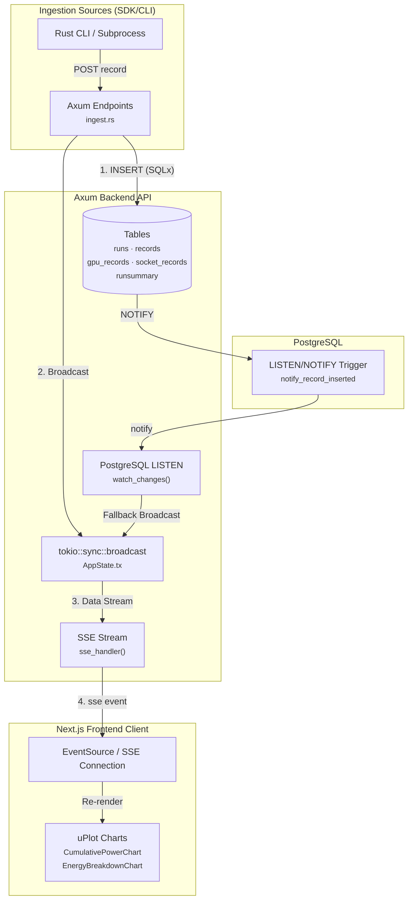

# EcoCode Web Platform — Complete Architectural Analysis

The **EcoCode Web Platform** (`@[EcoCode/web]`) is the central control hub and visualization layer of the EcoCode ecosystem. It is composed of a high-performance **Rust (Axum) API backend** and a modern **Next.js frontend dashboard**. The web app handles client authentication, ingestion of telemetry streams from the CLI and Python SDKs, server-side carbon footprints calculation, and real-time graph updates.

---

## 1. High-Level Architecture & Communication

The following diagram illustrates how telemetry moves from ingestion endpoints to database tables, and then streams in real-time to the browser interface:



---

## 2. Rust Axum Backend (`web/backend`)

The backend is built as a single-binary Axum server that manages multi-tenant workspaces, carbon configurations, and time-series metrics ingestion.

### I. Routing & State Management: [main.rs](../../web/backend/src/main.rs)
* **Entrypoint**: The [`main`](../../web/backend/src/main.rs#L46-L168) function configures database connection pooling (using `sqlx::postgres::PgPoolOptions`), executes migrations via [`ensure_postgres_schema`](../../web/backend/src/db/schema.rs#L5-L331), instantiates the shared `AppState`, and spawns the Server-Sent Events (SSE) database listener task.
* **Middlewares**:
  * **[`rate_limit_middleware`](../../web/backend/src/main.rs#L170-L203)**: Guards authentication routes (`/api/auth/register`, `/api/auth/login`) against brute-force attacks by validating IP client headers (`X-Forwarded-For`, `X-Real-IP`).
  * **[`security_headers_middleware`](../../web/backend/src/main.rs#L205-L219)**: Injects security headers like `X-Frame-Options`, `Content-Security-Policy`, and `X-Content-Type-Options`.

### II. Telemetry Ingestion API: [ingest.rs](../../web/backend/src/api/ingest.rs)
Four endpoints handle telemetry from running scripts:
* **[`ingest_run`](../../web/backend/src/api/ingest.rs#L31-L99)**: Creates a new row in the `runs` table, links it to a project, and sets the state to `running`.
* **[`ingest_record`](../../web/backend/src/api/ingest.rs#L103-L267)**: Accepts time-series records. It processes CPU, Memory, GPU details, and socket breakdowns inside a database transaction to ensure write integrity.
* **[`ingest_system_info`](../../web/backend/src/api/ingest.rs#L270-L322)**: Saves stationary host details (e.g. CPU name, core count, RAM size, GPU list) to the database.
* **[`ingest_complete_run`](../../web/backend/src/api/ingest.rs#L326-L372)**: Updates status to `finished` or `failed`, calculates cumulative carbon footprint figures, and broadcasts update triggers.

### III. Server-Sent Events (SSE) Engine: [sse.rs](../../web/backend/src/api/sse.rs)
EcoCode uses a dual SSE notification model to push updates to the UI in less than a second:
* **In-Memory Channel**: Upon receiving a record, [`ingest_record`](../../web/backend/src/api/ingest.rs#L103-L267) broadcasts the JSON string directly onto the `tokio::sync::broadcast` channel. This routes the payload immediately to active connections through [`sse_handler`](../../web/backend/src/api/sse.rs#L40-L86).
* **Database Channel (LISTEN/NOTIFY)**: The background task [`watch_changes`](../../web/backend/src/api/sse.rs#L88-L157) establishes a persistent postgres listener. If a database insert occurs, PostgreSQL triggers the `record_inserted` channel to publish the ID. The listener fetches the record details and forwards it to the broadcast stream. This prevents loss of events in multi-instance horizontal scaling environments.

---

## 3. Database Schema: [schema.rs](../../web/backend/src/db/schema.rs)

The database schema is mapped inside PostgreSQL. Core relations include:

```
  ┌───────────────┐        ┌───────────────┐        ┌─────────────────────┐
  │     users     │───────◄│  workspaces   │───────◄│  workspace_members  │
  └───────────────┘        └───────────────┘        └─────────────────────┘
                                   │
                                   ▼
                           ┌───────────────┐
                           │   projects    │
                           └───────────────┘
                                   │
                                   ▼
                           ┌───────────────┐        ┌─────────────────────┐
                           │     runs      │◄───────│  run_system_info    │
                           └───────────────┘        └─────────────────────┘
                                   │
                                   ├────────────────────────┐
                                   ▼                        ▼
                           ┌───────────────┐        ┌─────────────────────┐
                           │    records    │        │     runsummary      │
                           └───────────────┘        └─────────────────────┘
                                   │
                    ┌──────────────┴──────────────┐
                    ▼                             ▼
         ┌────────────────────┐        ┌────────────────────┐
         │    gpu_records     │        │   socket_records   │
         └────────────────────┘        └────────────────────┘
```

* **`users`**: Stores client login accounts and profile descriptors.
* **`workspaces`** & **`workspace_members`**: Manages teams and access permissions.
* **`projects`**: Holds project identifiers, carbon configurations, and regional grid intensities.
* **`runs`**: Tracks telemetry runs and stores launch command strings.
* **`run_system_info`**: Captures hardware specs.
* **`records`**: Stores core metrics for CPU, RAM, and GPU.
* **`gpu_records`** & **`socket_records`**: Normalizes sub-component measurements (multi-GPU, multi-socket RAPL).
* **`runsummary`**: Stores calculated run results (cumulative carbon in grams, total cost, average usage ratios).

---

## 4. Next.js Frontend App (`web/frontend`)

The frontend is built using Next.js (App Router), TailwindCSS for layout, and **uPlot** for high-frequency chart rendering.

### Core Frontend Directories:
* **[frontend/app/](../../web/frontend/app)**: Contains route pages such as workspace structures, user onboarding screens (`login`, `register`), and custom project layouts.
* **[frontend/components/charts/](../../web/frontend/components/charts)**: Handles high-performance uPlot wrappers:
  * **`EnergyChart.tsx`**: Compiles real-time power profiles.
  * **`CumulativePowerChart.tsx`**: Visualizes cumulative consumption.
  * **`PhaseTimeline.tsx`**: Draws timeline markers (e.g. `forward`, `backward`, `eval`) relative to energy load curves.
* **[frontend/components/run/](../../web/frontend/components/run)**:
  * **`EnvironmentalImpact.tsx`**: Converts energy stats to physical equivalents (e.g. tree seedlings grown, miles driven, smartphone charges).
  * **`CarbonSettings.tsx`**: Configures regional grid defaults and electricity price matrices.

---

## 5. Deployment Setup

The platform includes setup manifests to simplify self-hosting:

* **[docker-compose.yml](../../web/docker-compose.yml)**: Configures the multi-container stack, separating the Axum `backend` service (listening on `3001`) from the Next.js `frontend` service (listening on `3000`).
* **[Caddyfile](../../web/Caddyfile)**: Configures the reverse proxy. It routes incoming traffic matching `/api/*` to the Axum server (port `3001`) and sends all other requests to the Next.js app (port `3000`), with built-in HTTPS routing.
